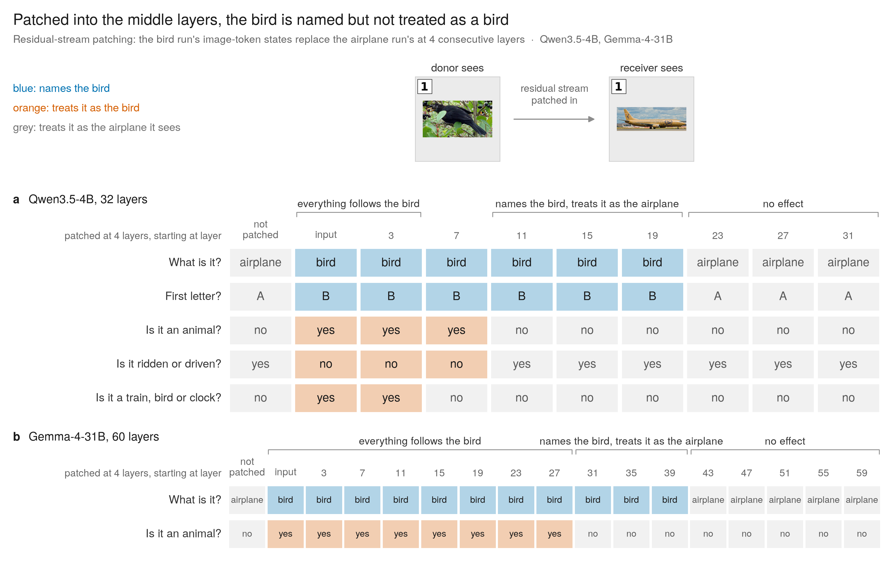
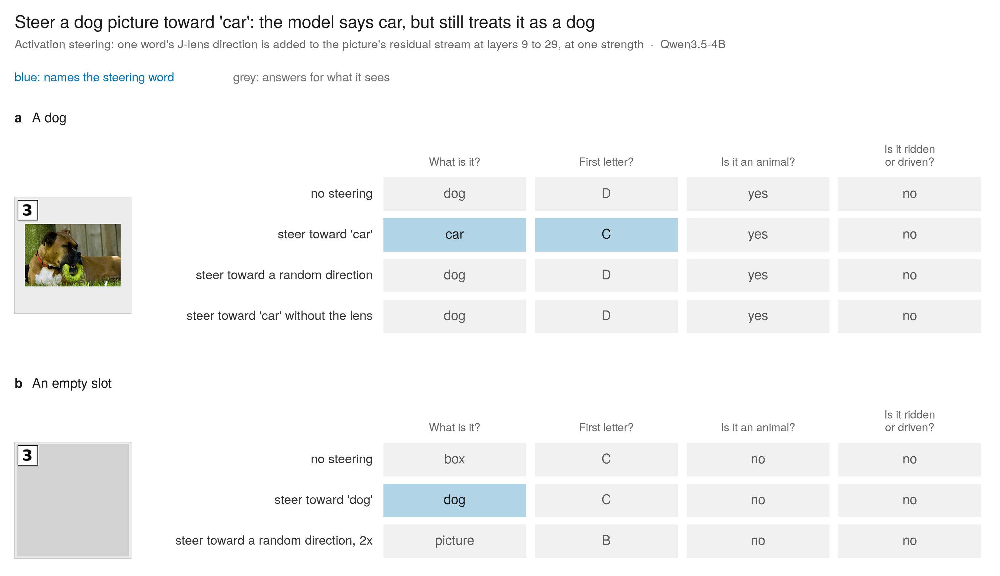
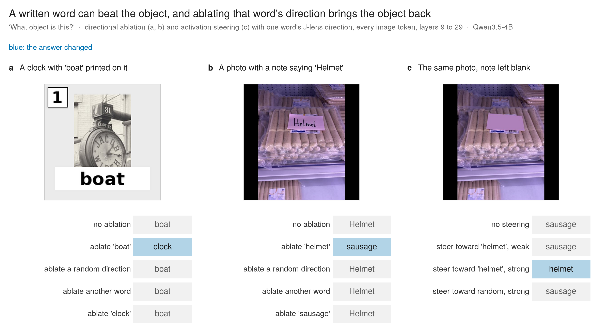

# jspace-horizons

Experiments that read, patch, ablate and steer the image-token states of vision-language models (Qwen3.5, Gemma-4) with the [J-lens](https://arxiv.org/abs/2607.15495). The repository has the code, the data and model pins, and the outputs of the original runs, so every result can be reproduced and checked.


*Residual-stream patching across depth: a donor's image-token states written into a receiver, four layers at a time (`depth_sweep`).*


*Activation steering with a word's J-lens direction (`name_steering`).*


*Directional ablation of a written word's J-lens direction (`printed_word`, `scam_notes`).*

More figures, every input at full size, and every answer shown with its prompt are in [`results/examples/`](results/examples).

## Quickstart

Requirements: Linux, an NVIDIA GPU, [uv](https://docs.astral.sh/uv/), and the DejaVu fonts (`apt install fonts-dejavu-core`).

```bash
git clone https://github.com/the-infiltrator/jspace-horizons && cd jspace-horizons
uv sync                       # Python 3.12 and the exact package versions (uv.lock)
uv run scripts/download.py    # data, Qwen3.5-4B and its lens at pinned revisions, checked by sha256 (about 11 GB)
scripts/reproduce.sh          # the Qwen3.5-4B runs, the figures, and the comparison with results/
```

To try one experiment on four scenes (a few minutes):

```bash
uv run experiments/depth_sweep.py --n 4 --run try_depth_sweep
```

## Experiments

| script | what it does |
|---|---|
| `depth_sweep` | patches a donor's image-token states into a receiver one four-layer window at a time, from the input to the last layer |
| `back_patching` | writes the same states at earlier or later layers, and restores the receiver's own states in between |
| `subspace_patching` | patches only part of the state: the lens subspace, its complement, or random subspaces |
| `name_steering` | removes or adds a word's lens direction on an object's image tokens |
| `gqa_ablation` | ablates lens subspaces and single lens directions from GQA photos |
| `printed_word` | ablates the lens direction of a word printed on an object |
| `scam_notes` | the same on SCAM photos with a hand-written note, plus steering |
| `read_battery` | the depth sweep at single-layer resolution with log-probabilities, 19 questions (18 plus a sixteen-way identification with a letter answer) crossing what is needed with the answer's form, other objects in the other slots with `--distractors`, and a dose-response mix (21 Oct) |
| `attention_knockout` | blocks attention from the text to the image tokens at softmax layers (a subset with `--layers`), head by head with `--heads`, with other objects on the canvas with `--distractors`, or to a word in a typed sentence with `--typed` (21 Oct) |
| `lens_onset` | at which layer the J-lens, J++ and the logit lens first read an object's name off its image tokens, pooled and per token (21 Oct) |
| `gqa_knockout` | the knockout on GQA photos with the benchmark's own question kinds (21 Oct) |
| `bench_knockout` | the knockout on CountBench (counts 2 to 10) and MathVision (direct-answer setting) (21 Oct) |
| `head_patch` | writes one donor head's attention output (the input of o_proj) into the receiver at the question's tokens: which heads are sufficient readers (21 Oct) |
| `cross_modal_patch` | the interchange: the heads' outputs recorded while the model reads a typed word, written into the run that sees a picture, and the reverse; per-head cosines across modalities (`--alignment-only`) (21 Oct) |
| `source_report` | after an interchange, asks whether the object was seen in the picture or read in a note: does the report follow the content's channel? (21 Oct) |
| `media_steer` | the steering, knockout and ablation assays on video clips and sounds (VGGSound): from which layers a word's lens direction on the media tokens is said; design and rule in `plan.md` (not yet run) |

The 21 October scripts also take `--model Qwen/Qwen3.5-2B`, `Qwen/Qwen3.5-0.8B` and `google/gemma-4-E4B-it` (pinned in `src/jspace/config.py`); their outputs are under `runs/` and are not part of `results/`. `scripts/fig_battery.py` draws their figures and `scripts/summarize_knockout.py` rebuilds a knockout summary from its CSV.

Each script writes `runs/<run>/<model>/`: a CSV of every answer, `summary.json` (estimates, 95% bootstrap intervals, verdicts), `stimuli.png`, `config.json` and `run.log`. `--help` gives each design; [RESEARCH.md](RESEARCH.md) gives the method and controls.

## Reproducibility

`scripts/reproduce.sh` downloads what is missing, runs the ten experiment runs, draws the figures into `runs/examples/`, and runs `scripts/check.py`, which compares every answer, verdict and number with `results/`. Finished runs are skipped on a restart. Data goes to `data/` and models to the Hugging Face cache (`HF_HOME`); neither is part of the repository. Gemma-4-31B is opt-in: `GEMMA=1 scripts/reproduce.sh` (or `download.py --gemma`) adds its 69 GB download and two runs; without it the figures take its outputs from `results/`.

| | runs | time (RTX PRO 6000, 96 GB) | GPU memory |
|---|---|---|---|
| Qwen3.5-4B | 8 | about 1 hour | up to 50 GB |
| Gemma-4-31B | 2 | about 45 minutes | up to 88 GB |

An exact match needs a GPU with at least 80 GB, since batch sizes follow GPU memory; on another GPU type a few answers can change, and `check.py` lists each one.

| pinned | |
|---|---|
| packages | `uv.lock` (torch 2.8.0+cu128, transformers 5.19.0, flash-linear-attention 0.5.2) |
| J-lens code | [anthropics/jacobian-lens](https://github.com/anthropics/jacobian-lens) at `581d398` |
| models | `Qwen/Qwen3.5-4B` at `851bf6e`, `google/gemma-4-31B-it` at `842da37` |
| lenses | [`neuronpedia/jacobian-lens`](https://huggingface.co/neuronpedia/jacobian-lens) at `e166deb`, sha256-checked |
| data | COCO 2017 val, `BLISS-e-V/SCAM` at `8c674f5`, `lmms-lab-encoder/GQA` at `a6e72d6`, sha256-checked |
| judge | `gemini-2.5-flash`; the original verdicts in `results/judge_cache.json`, so no API key is needed when answers match |

## Layout

```
src/jspace/     shared code: model and lens session, lens readouts, interventions, stimuli, judge, statistics, run folders
experiments/    one script per experiment
scripts/        download.py, reproduce.sh, make_figures.py, check.py
results/        outputs of the original runs (13-14 Oct 2026), the reference for check.py
tests/          CPU tests: uv run pytest
```

[AGENTS.md](AGENTS.md) has the rules for changing the code; [TASK.md](TASK.md) the current task.

## Credits

The J-lens is from [Gurnee et al. (2026)](https://arxiv.org/abs/2607.15495) and [anthropics/jacobian-lens](https://github.com/anthropics/jacobian-lens) (Apache 2.0); the fitted lenses are Neuronpedia's. Models: [Qwen3.5](https://huggingface.co/Qwen/Qwen3.5-4B) and [Gemma 4](https://huggingface.co/google/gemma-4-31B-it), under their own licences. Data: [COCO](https://cocodataset.org) (annotations CC BY 4.0), [SCAM](https://huggingface.co/datasets/BLISS-e-V/SCAM) (CC BY-NC 4.0), [GQA](https://cs.stanford.edu/people/dorarad/gqa/) (CC BY 4.0).

## 21 October 2026: the read-depth, cross-modal and source-report experiments

The second round of experiments (RECORD.md rows 77 to 133) is in this repository in full.

- `experiments/`: `read_battery.py` (single-layer patching with log-probabilities), `attention_knockout.py` (the reads of the image tokens blocked per layer, head and query token), `head_patch.py` and `cross_modal_patch.py` (head-output patching and the interchange between a typed word and a picture), `query_knockout.py`, `source_report.py`, `source_conflict.py` and `source_cause.py` (the model's report of whether it saw or read an object, with the answer held), `lens_onset.py`, `gqa_knockout.py`, `bench_knockout.py`.
- `results/oct21/<run>/<model>/`: every run's `config.json`, per-scene CSV (gzipped, `pandas.read_csv` reads it as is), `summary.json` and stimuli; `results/oct21/chains/` the shell chains that ran them; `results/figures/` every figure, each from a summary or CSV (`scripts/fig_battery.py`).
- `docs/`: `REPORT.md` (the write-up, with the story in four sentences at the top), `RECORD.md` (the ledger: every rule written before its run, every miss kept), `rubric.md` (the release constitution), `PROTOCOL.md`, `writing_rules.md`, `notes.md`, `handoff_21oct.txt`.
- `share/`: the note for Noah, the slide figure list, the council pass with the full gate-by-gate scoring, and the blind judge sheets.
- `results/tables/`: every result as flat CSVs (every summary value with its interval, the knockout costs and stations, the battery depths and curves, the access profiles), written by `scripts/export_tables.py`.
- `results/samples/`: the inputs at the size the models received them: every tile of the 2B and 4B crop banks and every receiver canvas of the 64 scenes, the 48 GQA photos, the 400 CountBench photos and the SCAM photos, each with its questions (`scripts/fig_examples21.py`, `scripts/export_photos.py`).
- `results/oct14_figures/`: every figure and stimulus sheet of the 13 and 14 October runs.
- `docs/ATLAS.md`: everything that was tried, by model, dataset and method, with the ledger rows and the finding for each.
- `jbound/`: the 13 and 14 October code, with the original notebook under `jbound/original/`; the vendored J-lens source it used is [anthropics/jacobian-lens](https://github.com/anthropics/jacobian-lens) and is not copied.

The headline: a vision-language model reads a picture with the circuit it reads a word with; every read closes at an ordered depth (decisions before the name) in seven models of two families; and the 4B's and Gemma E4B's report of whether they saw or read an object records the pathway that delivered the answer, with the answer held fixed and with nothing blocked (RECORD rows 115, 129, 132, 133). Status under the rubric: not release-ready while human labels, an outside replication and a red team are missing (`share/council_full_scoring_21oct.md`).
