# A vision-language model reads a picture with the circuit it reads a word with: an object's image tokens are read for meaning early and for the name late

## The story in four sentences (kept current; last changed 21 October 14:55)

In Qwen3.5 (0.8B, 2B, 4B, 9B) and Gemma-4-E4B an object's picture is read at two stations, an early one for every single-object decision tested (rules, category words, a sixteen-way identification) and a late one for its name, and on the Qwen 2B the heads that read the picture at each station are the heads that read the object when it arrives as a typed word; on the Qwen 27B and Gemma 31B the two reads keep their order and their shares of depth and lose their sharpness, spread over many layers with the decisions' read ending before the name's. The early station is where the picture is read for a decision and not where the decision is sealed: the reader heads' outputs recorded while the model reads the word dog, written into the model that sees a cat, make it treat the cat as an animal on 0.98 of scenes (2B), 1.00 (4B) and 1.00 (Gemma E4B, the second family) and say dog on 0.95 (2B), even from the late name heads alone. Shown a picture and a note that name the same object, the 4B answers the same word either way, and its report of where the answer came from follows the pathway that carried it: with the picture's reads blocked it says it read the answer on 64 of 64 scenes, with the note's reads blocked it says it saw it on 62 of 62, so the report follows the pathway that carried the answer, and it does so with nothing blocked: the heads of a run whose answer came from the note, written into the run that sees the picture, make it say it read the answer on 64 of 64 scenes, while a disruption of the same size without that content moves 1 of 64 (the 2B says "read" whenever a note exists, a format inference, and the 4B does the same when asked for the channel before the name, so the record exists only in the name-first order), and Gemma-4-E4B, the second family, gives the same answer-held result by knockout (read on 53 of 53 scenes with the picture's reads blocked, seen on 60 of 60 with the note's). A text-trained lens shows the name on the picture's tokens the whole time, so a lens reading cannot say what the model decided from, when, or from which channel.

This report sets out the J-space experiments run on Qwen3.5 and Gemma-4 vision-language models on 13 and 14 October 2026: the question, the setup, every test and its result, and what failed. Each number comes from a row of RECORD.md, where the rule a test was judged by was written before the test was run; the raw per-scene outputs are in runs/ and in share/jspace_results_14oct.zip. Debanshu's pilot is where this started: a lens fitted on text named a photographed object 95 to 100% of the time, and swapping the object's lens direction flipped the model's answer.

## The claim

A vision-language model reads an object's image tokens for two purposes and stops each at its own depth. Every rule the model applies to the object (is it an animal, do people ride it, is its name on a list) stops reading the object's tokens early, at about 0.3 of the layers in Qwen3.5 and 0.4 to 0.48 in Gemma-4. Saying or spelling the object's name keeps reading them until about 0.7. Both depths are the same within 0.06 of depth whether the object arrives as a photo, as its name printed in the picture, or as a typed sentence. After the early depth the fact is still in the tokens' state: a simple classifier decodes it at every layer, and the same state back-patched into earlier layers is used again. A text-trained lens, the tool used to read a model's workspace, shows the object's name on its image tokens at every depth, before, during and after the two reads, so a lens reading cannot say whether or when the content it shows is used (this replaces the 14 October claim that the lens first finds the name after the model stops reading it, which the J++ lens and per-token readouts overturned on 21 October).

On 21 October the claim grew two parts (RECORD.md rows 97 to 108), both scoped to the tested Qwen sizes. The heads that read the picture at each station are the heads that read a typed word (2B at the head level, 4B at the layer level), and what they deliver transfers across modalities: their outputs recorded while the model reads the word, written into the run that sees another object, make the model decide and, on the 2B, name as the word says. The channel travels apart from the content and the 4B's report of where its answer came from follows the pathway that delivered it: given only the name station's output it says it saw what it read; with a note and a picture naming the same object it says "read" when the picture's reads are blocked and "seen" when the note's are, with the answer identical (rows 110, 112 and 115). The 2B's report is a format inference and fails the gate. Gemma's interchange is queued.

Three results carry the 14 October claim. Patching a donor's image-token states into a model that sees a different object, one window of four layers at a time, shows the two cutoffs directly, in five models and three input types. Back-patching the donor's states from layers 11 to 14 into layers 7 to 10 makes the receiver use a fact it ignored when the same vectors were patched at layers 11 to 14 (0.91 against 0.05 on the 4B, 0.91 against 0.14 on the 2B). Steering every image token with another object's name direction makes the 4B say that object on 0.88 of scenes while its animal rule follows the actual picture on 0.94.

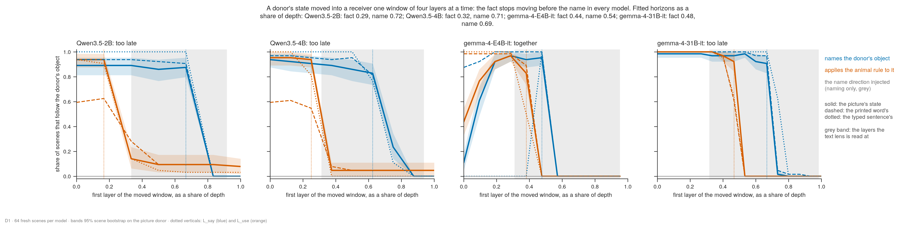
Figure: a donor's image-token states patched into a receiver one window of four layers at a time; x is the first layer of the window as a share of the model's depth, y the share of 64 scenes on which the receiver names the donor's object (blue) or applies the animal rule to it (orange); solid lines are a photo donor, dashed a printed-word donor, dotted a typed-sentence donor; dotted verticals mark the last window that still changes each answer; the grey band is the layers the text lens is read at in each model. Source: this work, runs/run4.

## tl;dr

- The animal rule stops reading an object's image tokens at 0.26 to 0.33 of depth in Qwen3.5 0.8B, 2B and 4B, and at 0.38 to 0.48 in Gemma-4-E4B and 31B; naming stops at 0.67 to 0.75 in every model whose later layers can be read, the same for photos, printed words and typed sentences within 0.06.
- Every rule tested reads early, including a rule about the name itself ("is it a cat, a cup or a horse?"); saying and spelling the name read late (five properties on the 4B).
- The late state still holds the fact: a classifier decodes "animal or not" from it on 0.89 to 0.97 of scenes at every layer, and back-patched into the early layers it is used on 0.91.
- Each half of the state carries the name and neither carries the fact: patched at the middle layers, either the 256 directions the lens reads most or the other 2304 make the 4B name the donor's object and classify its own on 0.75 of scenes.
- On 64 crops never used before, steering the picture with another object's name direction makes the 4B say it on 0.88 and the 2B on 0.97, while the animal rule follows it on 0.06; a random direction and the plain output direction do nothing at that dose.
- 21 October: on the 27B and the Gemma 31B the two reads keep their order and their shares of depth (27B: decisions end at layer 39 of 64, copies at 47; 31B: 29 and 42 of 60, 0.48 and 0.70) and lose their sharpness, spread over many layers with no single layer costing a nat (rows 120, 128).
- 21 October: the same heads read a typed word and a picture, and their outputs are interchangeable across the two (the animal rule follows a read word written into a seen picture on 0.98 of scenes on the 2B, 1.00 on the 4B and 1.00 on Gemma E4B; the name on 0.95 on the 2B only; the sixteen-way identity on 0.92 to 1.00). With a picture and a note naming the same object, the 4B's answer is the same from either source and its report of where it came from follows the pathway that carried it: read on 64 of 64 scenes with the picture's reads blocked, seen on 62 of 62 with the note's blocked. With a conflicting note it names the picture's object and says seen, and with the picture blocked names the note's and says read on 53 of 53 flipped scenes.
- 21 October, later: the 4B's report records the pathway with nothing blocked. With the picture present and unblocked, the heads of a run that answered from the note, written in at the five station layers, make it say read on 64 of 64 scenes, while noise of the same size moves 1 of 64 and the heads of a run that saw another picture of the same object 0 of 64 (row 129). Asked for the channel before the name it says read on 0.98 of clean scenes, so the record exists only in the name-first order (row 130). The 9B (32 layers) has the 4B's stations within one softmax layer, so within Qwen the concentration is lost between 32 and 64 layers (row 131); across all seven models the read sits in the same window of depth and is shared by more layers in a deeper model. The second family agrees on the source report: Gemma-4-E4B, by knockout, says read on 53 of 53 scenes with the picture's reads blocked and seen on 60 of 60 with the note's, the answer held throughout (row 132).
- Withdrawn on 21 October: the claim that the lens first reads an object's name off its image tokens at 0.71 to 0.83 of depth. With the J++ lens, and with the J-lens read token by token, the name is in the top ten from layer 2 of 24 on the 2B (pooled) and from the input on some image token, with a null of 0.00; the J-lens's late pooled onset was the instrument and the pooling.
- Ablating the answer word's single lens direction from natural photos costs about 2600 divided by the model's width in nats, in Qwen3.5 0.8B, 2B and 4B; the 2B was predicted at 1.02 to 1.52 before it was run and measured 1.34.
- The 27B patching runs crashed and the video version failed its own check. The natural-photo tests ran on 21 October (GQA by patching, CountBench by knockout, below).

## 21 October: what sets the depth at which a question stops reading the picture

Noah asked three things after the 14 October results: is the cutoff a step or a slope, how consistent is it across concepts, and does a question that needs more computation read the picture earlier. Four accounts were written down before the runs (RECORD.md, 03:25): fixed stations, just in time (more downstream steps, earlier read), readiness (the read waits for the needed feature to form in the token), and a distributed sum that only looks sharp. Two methods test them on the same 64 scenes.

Patching at single-layer resolution with log-probabilities. The donor's image-token state is written in at the output of one layer L, for every L; the receiver's text positions then read the receiver's object up to layer L and the donor's from L + 1 on. The estimand is log p(X's answer) minus log p(Z's answer) at the first answer token, in nats. Eighteen questions cross what the question needs (the word form, the category, world knowledge, a rule over names, a conjunction, a negation) with the form of the answer (a digit, a letter, a word). A question counts for a model only when the receiver alone answers it right on 0.85 of scenes.

Attention knockout, the second method. On the receiver alone, attention from every text position after the image to the image tokens is blocked at chosen softmax-attention layers (in Qwen3.5 one layer in four has softmax attention; the other three are linear attention and cannot be blocked). The cost of a knockout is the drop in the same log-probability difference.

On the 4B every decision stops reading the picture at the same place and every copy of the word form at another, whatever the question needs and whatever form the answer takes. The animal rule, its negation, the rule over one, three or five names, the conjunction of a category and a word-length condition, "animal, vehicle or other" answered with a word, and "animal? yes or no" all read until layer 9 or 10, so the read ends at softmax layer 11. Saying the name, its first letter and its French translation read until layer 22, so the read ends at softmax layer 23. The knockout names the same layers: blocking layers 7 and 11 costs a decision 2.5 nats each and nothing from 15 on; blocking 11, 15 and 19 costs naming 1.5 to 2.1 nats each, with a cumulative tail to 23. On the 2B the two stations are softmax layers 7 and 19 by both methods: every decision reads until layer 6 by patching (the rule over one, three or five names, the conjunction, the negation, the category word, yes or no), every copy until 18 (the name, its first letter, its plural; French until 15), and the knockout's readers are 7 for the decisions and 7, 11, 15, 19 for the copies. The rule over five names and the conjunction read at the same layer as the rule over one name.

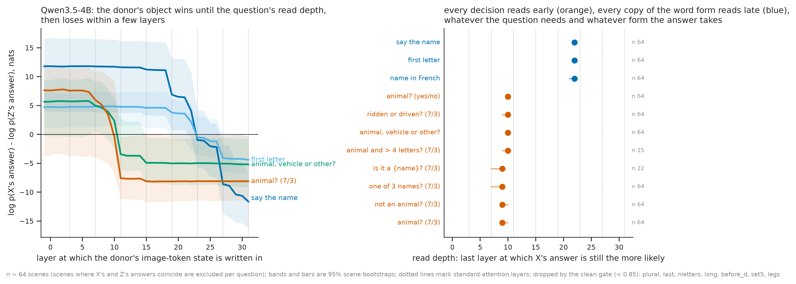
Figure: left, log p(X's answer) minus log p(Z's answer) by the layer at which the donor's image-token state is written in, for five questions, with 95% scene bootstraps; right, the read depth of every question that passes the clean gate (the last layer at which X's answer is still the more likely), decisions in orange and copies of the word form in blue. Qwen3.5-4B, 64 scenes. Source: this work, jspace-horizons/runs/run7/Qwen3.5-4B.

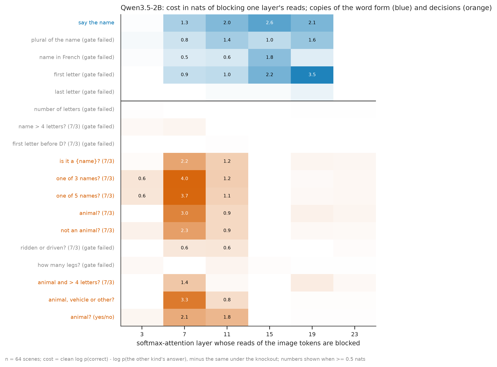
Figure: the cost in nats of blocking one softmax layer's attention from the question to the image tokens, for every question (rows) at every softmax layer (columns); copies of the word form above the line, decisions below; questions that fail the clean gate in grey. Qwen3.5-2B, 64 scenes. Source: this work, jspace-horizons/runs/run7k/Qwen3.5-2B.

What this rules out. Just in time: the rule over five names and the conjunction read no earlier than the rule over one name or the animal rule (all 9 to 10 on the 4B, all at layer 7 on the 2B), and the first letter reads with the name, not between the name and the rules. Readiness: the rules over names, which need the word form, read at the decision station, five softmax layers before the word form is copied. "Any word reads late": the category word and yes or no read at the decision station. What is left is the simplest account: two stations, and a question's station is set by whether its answer is a decision about the object or a copy of its word form.

Step or slope. A decision's log-probability difference is flat from the input through the patch at layer 7 and reaches its clean value by the patch at 11 (animal: +6, +5, +3, 0, -8 nats at patches 7, 8, 9, 10, 11), a transition of four to five layers, one block between two softmax layers. A copy's falls in three steps, at 19, 23 and 27 (say: +11 at 15, +7 at 19, +4 at 22, -1 at 23, -9 at 27), a graded read over three softmax layers. So Noah's two intuitions are both right, for different reads: the decision read is a few readers at one station, the copy read is a sum over three.

Consistency across concepts. Per scene, the animal rule's read depth has a median of 9 with an interquartile range of 1, and 0.92 of scenes are within one layer of it; naming has a median of 22, an interquartile range of 2, and 0.66 within one layer (values 22 to 26).

Dose. Mixing the donor's state into the receiver's at weight 0.75 leaves both depths unchanged (22 and 9) with the plateau reduced (9.6 against 11.8 nats, 6.3 against 7.6); at 0.5 the plateau is 0.8 and 0.1 nats, so the donor never clearly wins and no depth can be read. The pre-registered 0.5 clause is therefore undefined, and the test against the distributed-sum account rests on the 0.75 dose and the step widths.

The lens, corrected. Measured again with the J++ lens and token by token (RECORD.md row 81), the name is in the lens's top ten on the pooled image tokens from layer 2 of 24 on the 2B (0.52 of scenes, null 0.00) and on some image token from the input with the J-lens (0.94, null 0.02). The 14 October claim that the lens first sees the name after the model stops reading it is withdrawn; it came from pooling the tokens and from the J-lens's weakness in early layers. What stands is stronger and plainer: the name is visible on the image tokens at every depth, the model reads it for decisions at one station and for copying at another, and a lens reading does not say whether, or when, the content it shows is used.

The held-out model. The 0.8B was held out with the prediction that only the copy station would show, since its digit rules fail on pictures. It cannot answer the digit rules, but it answers "animal, vehicle or other" and "yes or no" on 0.97 of scenes, and those read at layers 7 and 11 and nowhere later, while the name and the French name read through 19 (row 86). The two stations are where the 2B's are.

The heads. Blocking one query head's attention from the text to the image tokens, at the station layers of the 2B: at layer 7 head 3 costs every decision 2.0 to 2.6 nats on its own and head 1 another 1.1 to 2.0, and the three costliest heads sum to more than the whole layer's cost, so the decision station is two heads. At layers 15 and 19 heads 1 and 5 cost the name 0.9 to 1.6 nats each, and no head at layer 7 costs the name more than 0.35. One head serves both: layer 11 head 4 costs the name 3.1 nats and the decisions 1.5 to 2.0, and keeping only that head at layer 11 leaves the name intact. So the readers are a few heads per station, against the distributed-sum account, with one shared head between the stations (RECORD.md row 85). On the 4B the decision station is head 4 at layer 11 (1.8 nats alone for the animal rule, the three costliest heads exceeding the whole layer's cost), while the copy read is spread over several heads at 11, 19 and 23 with none above 0.7 nats, so the 4B's copy read is more distributed than the 2B's (row 92).

A word is read like a picture. With the object given as the typed sentence "Image slot q contains a dog" and no picture, blocking attention to the word "dog" at one softmax layer costs every decision at layer 7 (animal 1.0 nat, not-animal 1.4, category 1.5, yes or no 1.5) and nothing after, and costs the name at 11, 15 and 19 (1.0, 1.1, 1.8), the picture's stations to the layer (RECORD.md row 95). The word differs from the picture in one way: blocking every softmax layer leaves the name 9.9 nats, against 4.2 for a picture, because a word's identity also flows through the linear-attention layers. The same heads read the word (row 99): with the typed sentence, blocking head 1 at layer 7 costs the category word 1.1 nats and head 3 costs it 0.8, head 4 at 11 costs the name 1.2, and head 5 at 19 costs the name 1.0 while blocking the other seven heads of 19 costs only 0.4. These are the picture's heads, to the head. On the 4B the typed word's last reader is within one softmax layer of the picture's for every question (decisions 7 to 11 against 11, copies 19 to 27 against 23, row 98).

Necessity and sufficiency sit at different stations (row 97). Writing one donor head's output into the receiver at the question's tokens (the per-head input of the attention output projection), the decision station's heads are necessary but not sufficient alone: all eight heads of layer 7 move the animal rule on 0.47 of scenes, because the read is redundant across layers 7, 11 and the linear layers, while head 5 of layer 19, the name head that no decision needs, moves it on 0.77 alone and the whole of layer 19 on 0.92. The copy needs its three layers together: all heads of 11, 15 and 19 written in at once make the model say the donor's name on 0.73, and no single layer does (row 101). So the word form delivered late carries the meaning, and the meaning delivered early does not carry the word form. The model decides late from whatever identity is at the answer position, and in a clean run the early read is what gets there first. On the 4B no single layer's heads suffice for either station (row 100), and the joint patches do (all heads of 15, 19 and 23 move the animal rule on 0.95).

What a reader delivers transfers across modalities, and the channel is not detectably in it (row 101). The donor reads "Image slot q contains a X." with no picture, the receiver sees a picture of Z with the same question, and the donor's per-head outputs at the question's tokens are written into the receiver. The receiver then applies the animal rule to the typed word's object on 0.98 of scenes (all heads of layers 7 and 11, clean 0.08, 0.86 with 11, 15 and 19) and says the typed word on 0.95 (all heads of 11, 15 and 19, clean 0.00). The reverse holds: the picture's read written into the run that reads the sentence moves the rule on 0.95 and the name on 0.41. The word's read is the stronger carrier, since into the same picture receiver the word donor gives the name on 0.95 and the picture donor on 0.73. No object carries the result: every donor class moves the rule on 0.91 to 1.00 of its scenes, and every donor word but one (bicycle, 0.00) is said on 1.00. What transfers is the identity and not a two-way decision: with the sixteen-way question as donor and receiver, the typed donor's heads at 7 and 11 make the picture receiver give X's letter on 0.92 of scenes and the three name-station layers on 1.00 (row 111). The vectors agree with the behaviour. At layer 19, head 5's output for a dog seen is closer to its output for a dog read than to a cat read by 0.33 in cosine (heads 0, 1 and 2 by 0.11 to 0.14), and a cat seen is no closer than a cat read (a modality component between -0.05 and +0.04 for every head of 19), so by this measure the name station's vector carries the object and no component for the channel. At layer 7 the heads carry the object at the question's slot token (head 6 by 0.22) and a channel component at the answer position, so the decision heads write the object where the rule reads it, and the comparison at the answer position does not speak to them. On the 4B the typed word's read written in at layer 19 alone (16 heads) moves the animal rule on 1.00 of scenes, and layers 15, 19 and 23 together on 1.00. The name does not transfer by head outputs on the 4B (0.41 at best, and 0.45 even from a picture donor), because its copy is spread over 16 heads at three softmax layers and the linear layers, so the per-head patch at the softmax layers carries less than half of it (row 106). "The same vector up to the object" is a 2B result at the name station and a joint-behaviour result on the 4B. On the 27B, whose read is spread over layers 27 to 47, the word's read moves the animal rule only when four layers' heads (35 to 47) are written in together (0.64, picture donor 0.94) and the name does not transfer with those layers (row 121); the interchange follows the read's shape at each size. On Gemma-4-E4B, the second family, the word's read written in at layer 29 alone moves the animal rule on 1.00 of scenes and at layer 17 on 0.64, with no single head above 0.05, and the name does not transfer (0.06 at best); at layer 29 the object vector is the same for seen and read up to the object by the cosine contrast, as at the 2B's name station (row 127).

Where in the question the object lands (runs/run13a). Measured at every question token, the decision heads of layer 7 deposit the object on one token: the word "animal" in the rule, the rule's own predicate (head 6 by 0.22 in cosine, heads 5 and 1 by 0.10 and 0.08, and nothing at the answer position). The name heads of layer 19 deposit it at the answer position and the assistant prefix (heads 5, 0, 2 by 0.33 to 0.14) and, for heads 1 and 3, at the rule's article and determiner tokens. So the picture is read for a decision where the rule names its test, and read for the name where the name is about to be written. The knockout restricted to one query token confirms it (row 109): blocking only the word "animal" from reading the picture at the decision station costs the animal rule 3.3 of the 4.9 nats that blocking every text token costs, blocking only the answer position costs nothing, and blocking every token but "animal" costs 1.6; for the name, blocking only the answer position at the name station costs 2.8 of 4.9 nats. The category word, which has three test words, spreads its read over them (the first alone 1.1 of 5.1). On the 4B the concentration is weaker and a held-out prediction failed: the word "animal" carries 0.39 of the animal rule's read and the word "ride" 0.13 of the ride rule's, under the 0.5 the rule asked for (rows 116 and 118). What holds on both sizes and every question is that a decision's read never goes through the answer position (at most 0.01 of the whole) and lands on the question's tokens before it, with the test word the largest single site where there is one. So the scoped statement is: a decision reads the picture at the question's tokens, concentrated on the word that names its test on the 2B and spread more widely on the 4B, and the name reads it at the answer position.

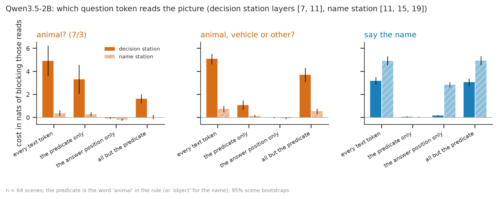
Figure: the cost in nats of blocking the picture reads of every text token, of the predicate token only, of the answer position only, and of every token but the predicate, at the decision station (solid) and the name station (hatched), per question. Qwen3.5-2B, 64 scenes, 95% scene bootstraps. Source: this work, jspace-horizons/runs/run18/Qwen3.5-2B.

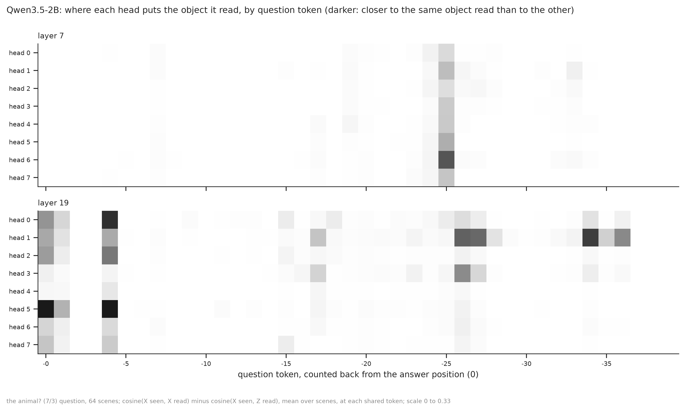
Figure: per head (rows) and question token counted back from the answer position (columns), how much closer the head's output is to the same object read than to the other object read, at layers 7 and 19. Qwen3.5-2B, 64 scenes, the animal question. Source: this work, jspace-horizons/runs/run13a/Qwen3.5-2B.

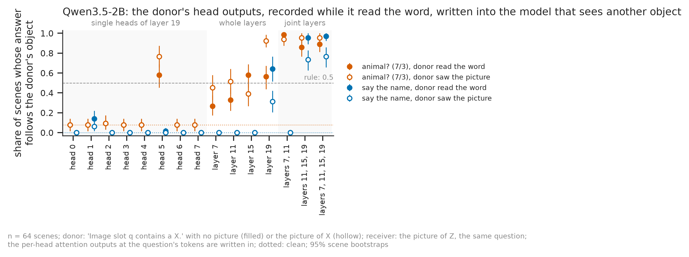
Figure: the share of scenes on which the picture receiver's answer follows the typed donor's object, for single heads of layer 19, whole layers and joint layers written in, with the picture donor hollow for comparison; animal rule in orange, name in blue; 95% scene bootstraps. Qwen3.5-2B, 64 scenes. Source: this work, jspace-horizons/runs/run13/Qwen3.5-2B.

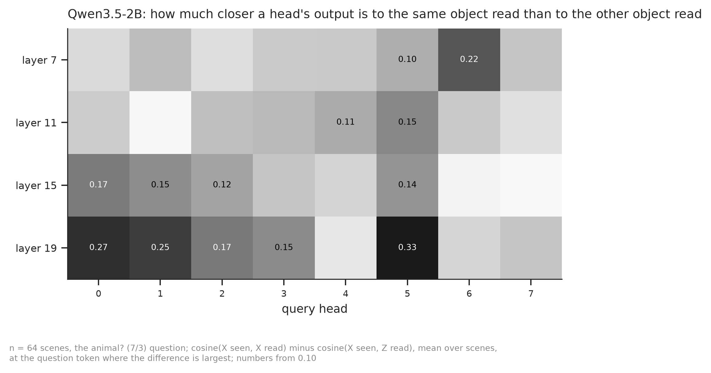
Figure: per head and layer, the cosine between a head's output for the object seen and for the same object read, minus the cosine for the other object read, at the question token where the difference is largest. Qwen3.5-2B, 64 scenes. Source: this work, jspace-horizons/runs/run13a/Qwen3.5-2B.

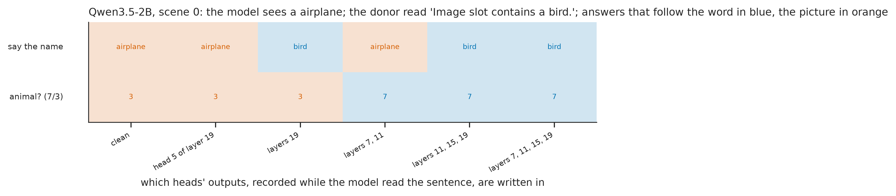
Figure: one scene, the model's answers with the sentence-reading donor's heads written in, arm by arm; answers that follow the word in blue, the picture in orange. Qwen3.5-2B. Source: this work, jspace-horizons/runs/run13/Qwen3.5-2B.

The resolution control (row 102). An outside review's strongest alternative was that the name reads late because it needs sixteen-way identity, and that the decisions read early because they need two-way category. A sixteen-way identification with a letter answer from a fixed list ("Which of these is the object in image slot q? A: airplane, ..., P: train.") reads the picture once, at layer 7, with 4.3 nats on that layer and nothing from 11 on, and its patching depth is the animal rule's (6 on the 2B). "Is it a cat?" (a two-way answer with sixteen-way discrimination) reads at 7 as well. The late station is where the word form is read, not where fine identity is. On the 4B the sixteen-way question reads at 11, the decision station, and once more at 15, one softmax layer later than the two-way decisions and two before the name's last reader (row 104), so on the larger size fine identity costs at most one extra station layer and the word form is still read apart.

Does the model say it saw what it read? (rows 103 and 105.) The receiver sees Z in slot q and reads "A note says: slot p contains a W." The donor reads notes about both slots (X in q) and sees no picture. The question asks for the object in slot q and whether it was seen in the picture or read in the note, in the form "name, seen" or "name, read". On the 4B every gate is met: the clean receiver answers "Z, seen" (0.89 names Z, 1.00 seen), the control slot "W, read" (1.00), the donor "X, read" (1.00). With the donor's heads at layers 19 and 23 written in, the 4B's name station, the receiver names the read dog on 0.44 of scenes and on 0.93 of those says it saw it. With layer 15's heads added, which carry a channel component (row 101), it names the dog on 0.48 and says it read it on 0.81, and with 11 to 23 on 1.00. The control slot's answer "W, read" is untouched by every patch. On the 2B, whose clean report is weaker (seen on 0.77 of clean scenes, a failed gate), the name station alone leaves the report at chance (0.48 seen, 0.52 read on the 0.88 of scenes that name the dog) and adding layer 11 makes it "read" on every scene. These shares are conditional on the name transferring, so the two arms were compared on the same scenes with the name held: on the 24 scenes where the 4B names the read object under both arms, the report is "seen" on 0.92 under the name station alone and "read" on 0.75 with layer 15 added, 16 of the 24 go from seen to read and none go the other way (2B: 27 of 56 flip, none back). So the object and the channel it came from travel through different heads. The source report follows the channel-carrying heads, and a model given only the object reports the channel the slot belongs to. This is the first result here on the model's account of its own evidence: the account can be wrong about where the content came from, the internal signal that predicts the error is which heads delivered the content, and adding the channel-carrying heads repairs it with the answer held. A control donor that read only a note about another slot, and nothing about slot q, shows the channel is bound to the object the heads deliver and is never a free report: its middle-layer heads make the receiver name the donor's read object with "read" attached (37 of 64 scenes, read on 1.00), and every scene that still names the picture's object says "seen" (25 of 25); no scene names the picture's object and says read (row 112). Two limits: the vector measure in row 101 says only that this cosine contrast finds no channel component at the name station, which is not the absence of channel information in the head output, and the two-source test above is the one with a real external cause.

Two real sources in conflict (row 110). The receiver sees Z in slot q and reads "A note says: slot q contains a X.", and is asked the same "name, seen or read" question. On the 4B, with both sources readable, it names the picture's object on 0.83 and says seen on 0.89, so the note is present and ignored and the report is right. Blocking the picture's reads at every softmax layer makes it name the note's object on 1.00 and say read on 1.00: 53 scenes flip from the picture's object to the note's, and the report goes from seen to read on 53 of 53. Blocking the picture only at the decision station (7 and 11) does the same (53 of 53), and only at the name station nearly so (52 flips, 0.96). Blocking the note's reads changes little, since the note rarely won (4 flips, too few to score), and blocking both leaves the note's object (its word reaches the answer through the linear layers). So on the 4B the source report tracks the channel that caused the answer, with the other channel present and ignored, which is the distinction between a source being present and a source being used. The 2B fails the gate: it says read whenever a note is in the prompt, whatever it names, so its reports are a format inference and are not scored.

The same answer from two sources (row 115). The decisive version holds the answer fixed: the note names the picture's own object, so the model answers the same word whichever source carried it, and only the pathway differs between arms. On the 4B (gates 1.00) the answer is the picture's object on 64 of 64 scenes under every block. With the picture's reads blocked at every softmax layer the report goes from seen to read on 64 of 64 scenes; with the note's reads blocked it stays seen on 62 of 62. Blocking the picture at the decision station alone moves 31 of 64, at the name station alone 2 of 64, so the "seen" report draws on the picture's reads at both stations and flips only when both are gone. Two runs with the same picture, the same note and the same answer: in one the picture carried the answer and the model says it saw it, in the other the note carried it and the model says it read it. The 4B's source report records which pathway delivered the content. One reading was still open after this design: blocking the picture's reads also removes the picture's evidence at the question's tokens, so a report computed from what evidence is present, the anomaly-detection account of [Singh, Linzen and Ravfogel (2026)](https://arxiv.org/abs/2605.26242), would move the same way, and a knockout can expose a fallback route rather than the intact run's ([Salazar et al. 2026](https://arxiv.org/abs/2607.03358)). The matched-disruption test below closes both. With row 105 this is a double dissociation in the rubric's sense: given a read dog's name-station heads, the 4B changes its answer to the dog and keeps the report "seen" (content moved, report held, 0.93 of the scenes that name the dog), and here, with the note and the picture in agreement, it keeps the answer and changes the report (content held, report moved, 64 of 64). That record is spread out: blocking the picture's reads for one query head at a time at the five station layers moves the report on at most 2 of 64 scenes for any head (row 117), while the object itself is carried by two heads (row 85). The channel evidence is a sum over many reads, the object a few.

Nothing blocked (row 129). The receiver sees the picture and reads the agreeing note, its attention to the picture intact, and a donor's per-head attention outputs are written into the tokens after the image at the station layers. Donor A read the same note with an empty canvas, so its answer came from the note. Donor B saw another crop of the same object with the same note, so the picture still delivered its answer. Donor N is the receiver's own outputs plus noise of A's size at every position, and donor C is the receiver itself. Every gate is met (clean "Z, seen" on 1.00, A alone "Z, read" on 1.00, B alone "Z, seen" on 1.00, and the null patch changes nothing on 64 of 64) and the answer is the picture's object on 64 of 64 scenes under every arm. A's heads at all five station layers make the model say it read the answer on 64 of 64 scenes, at the decision station alone on 23 and at the name station alone on 16. B's heads move it on 0 of 64 at every group and N's on 0, 0 and 1. B moves the outputs by 0.45 to 0.53 of A's displacement, under the pre-registered half, so N is the matched control and B the smaller one. So the report follows which pathway's output reached the question's tokens, with the picture seen and readable throughout, which is what a record of the computation predicts. The order of the two words bounds it (row 130): asked for the channel before the name ("seen, cup"), the 4B says read on 0.98 of clean scenes whatever carried the answer, the format inference the 2B makes in both orders, so the pathway-tracking report is a judgement made after the name is written and is not available before it. Both the matched-disruption test and the answer-held knockout replicate on a second scene set drawn from the original crops (row 133): the note-cause heads move the report on 64 of 64 again, noise on 0, and the picture blocked moves it on 64 of 64 with the decision station alone at 32.

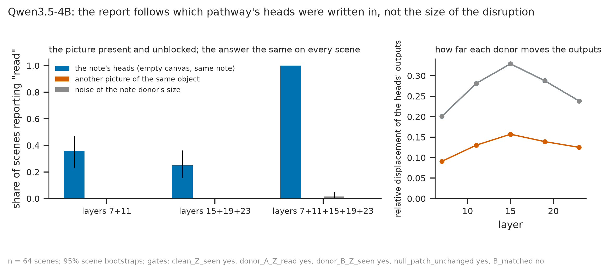
Figure: left, the share of scenes on which the model says it read the answer after a donor's heads are written in at each station group, the picture present and unblocked and the answer the same on every scene: the heads of a run that answered from the note (blue), of a run that saw another picture of the same object (orange), the receiver's own heads plus noise of the note donor's size (grey); right, how far each donor moves the heads' outputs, per layer. Qwen3.5-4B, 64 scenes, 95% scene bootstraps. Source: this work, jspace-horizons/runs/run20/Qwen3.5-4B.

The second family (row 132). Gemma-4-E4B, with every layer blockable, gives the same answer-held result by knockout. Its clean report is "seen" on 0.83 of scenes (the gate is 0.8). With the picture's reads blocked the answer is still the picture's object on 64 of 64 scenes and the report goes from seen to read on 53 of 53 scenes that had said seen. With the note's reads blocked it says seen on 60 of 60, and the 11 scenes that had said read turn to seen. Blocking the picture at the decision station alone (layers 11 and 17) moves all 53, at the name station alone (23 and 29) none, so on E4B the evidence of having seen sits entirely in the decision station's reads, where the 4B keeps half of it there (31 of 64) and the rest at the name station. With both channels blocked E4B loses the answer altogether, since it has no linear layers to carry the note's word, where the 4B still answers from the note through its linear layers.

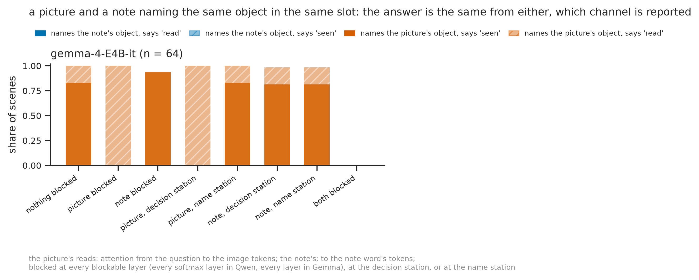
Figure: as the figure below, for Gemma-4-E4B with every layer blockable; the decision station is layers 11 and 17, the name station 23 and 29. 64 scenes. Source: this work, jspace-horizons/runs/run22/gemma-4-E4B-it.

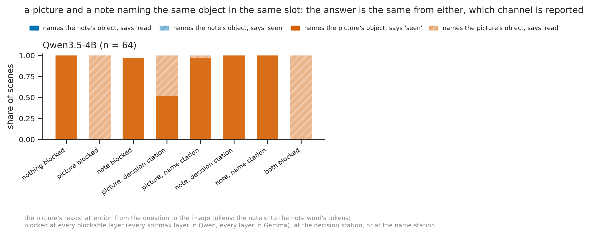
Figure: a picture and a note naming the same object; per arm, the share of scenes naming that object, filled when the report is "seen" (orange) and blue when "read"; the picture's or the note's reads blocked at every softmax layer, at the decision station or at the name station. Qwen3.5-4B, 64 scenes. Source: this work, jspace-horizons/runs/run19/Qwen3.5-4B.

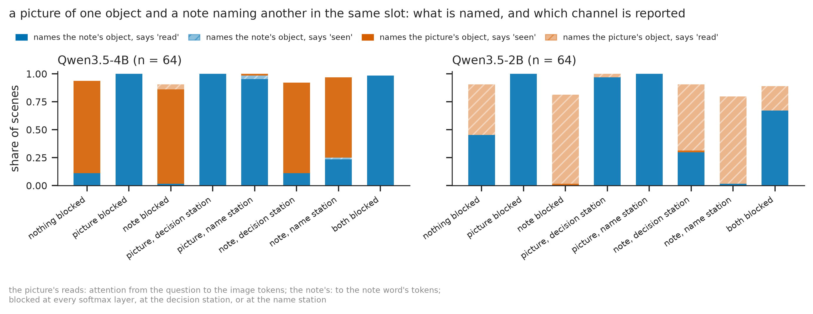
Figure: per arm, the share of scenes naming the note's object (blue) or the picture's (orange), filled when the reported channel matches the named object's channel and hatched when it does not; the picture's or the note's reads blocked at every softmax layer, at the decision station or at the name station. Qwen3.5-4B and 2B, 64 scenes each. Source: this work, jspace-horizons/runs/run17.

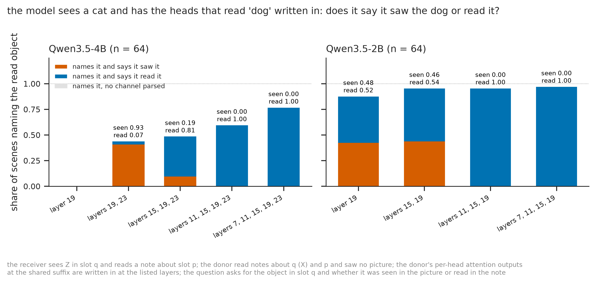
Figure: per written-in layer group, the share of scenes on which the picture receiver names the read donor's object, split by whether it reports having seen it (orange) or read it (blue). Qwen3.5-4B and 2B, 64 scenes each. Source: this work, jspace-horizons/runs/run15 and run15b.

On the 2B the natural-photo patching gives the same stations as on the 4B: decisions stop needing the photo at layer 7 (0.52 to 0.75 between the patches at 6 and 7), names at 15 to 19 (row 96).

Why a steered name is said and not used. The 14 October steering wrote a name's direction into the lens band (layers 9 to 29) and the model said it on 0.88 of scenes while the rules ignored it. The stations say why: the band starts after the decision station. Written before it (layers -1 to 10 on the 4B), the same direction at the same dose moves the rule over names on 0.48 of scenes and the animal rule on 0.23, and written after it (11 to 22) it moves them on 0.03 to 0.06, while it is said on every scene either way (row 93). The pre-registered threshold of 0.5 for the decisions was not reached, so the rule reads undetermined; the direction is as predicted. An intervention reaches a decision only if it lands before the decision station, and a lens reading taken after that station shows what will be said.

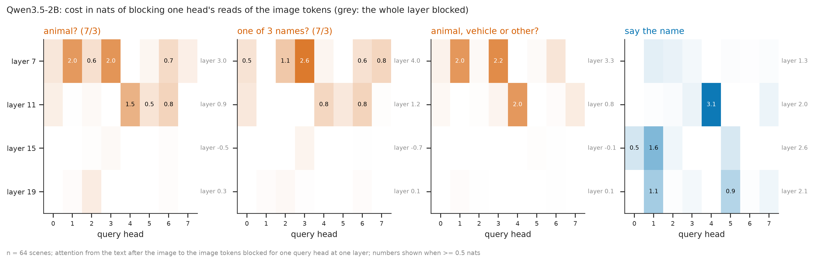
Figure: the cost in nats of blocking one query head's attention from the text to the image tokens, per head (columns) at each station layer (rows), for three decisions and the name; grey, the cost of blocking the whole layer. Qwen3.5-2B, 64 scenes. Source: this work, jspace-horizons/runs/run7h/Qwen3.5-2B.

Natural data. On 48 GQA photos with the benchmark's own questions (48 names, 48 attributes, 48 yes-or-no and either-or decisions, judge-scored) the knockout fails its pre-registered rule: no kind loses a nat when softmax layers are blocked, because on natural photos most of the read runs through Qwen's linear-attention layers, which the knockout cannot touch (blocking every softmax layer leaves names 0.46 correct against 0.60 clean, decisions 0.60 against 0.85). Post hoc, the accuracy profiles show the predicted order: decisions are back at 0.83 of 0.85 once only layers 15 on are blocked, names recover from 19, attributes from 23. The patching version, which reaches every layer, ran next: a grey image's token states are written into the photo's tokens from layer L on. On the 4B the decisions are at chance (0.48 to 0.54) for every L up to 10 and at their clean accuracy (0.83 to 0.85) from L = 11 on, a one-layer step at the canvas decision station; names stay at 0.17 to 0.35 through layer 18 and are back at their clean 0.60 from 19, the copy station; attributes climb from 15 to 23 (row 91). The pre-registered 1-nat threshold is not met by the decisions: a blank image leaves a two-way question near chance and never confidently wrong, so from a clean log-probability of -0.36 the cost is about 0.3 nats, and the rule, calibrated on the canvas where the receiver answers confidently for the other object, fails by its letter while the accuracy profiles show the stations transfer. Both readings are reported. On CountBench (491 photos, "how many X are there?", clean accuracy by count group 0.93 / 0.88 / 0.77 over all 491, of which 400 correctly answered photos were kept, all of them correct again on the knockout's own clean arm) the knockout gives a graded result that the pre-registered prediction got wrong: counts of 2 to 4 stop needing the softmax reads by layer 11, like the canvas decisions, counts of 5 to 6 by 15, and counts of 7 to 10 keep reading through 19 and 23 (accuracy 0.51 with layers 15 on blocked, 0.92 only from 23). The read depth grows with the count, the opposite of just in time, and it is a third kind of read: an accumulation over many image tokens that runs on into the copy station's layers (RECORD.md row 88). The 2B shows the same order in accuracy (counts 2 to 4 back at clean once only layers 11 on are blocked, 7 to 10 only from 19), while its pre-registered nat rule reads no movement, since the cumulative costs stay under the 1-nat threshold (row 90). Count 10 is an outlier on both sizes. MathVision was tried and dropped: in the direct-answer setting the 4B gets 2 of 60 right, so there is nothing to knock out (row 84).

Load (row 107). The same scenes with two or five other objects' crops in the other slots: the animal rule reads to layer 6 with five other objects exactly as with none, with the same readers (7 and 11) and only its margin lower (6.6 to 3.1 nats). The name's read ends one to three layers earlier by log-probability (17 and 15 against 18) and its transition broadens from 6 to 9 layers, with the same knockout readers (7, 11, 15, 19). No read goes deeper with load, so CountBench's read growing with the count is a property of counting and not of load on one object's read.

The second family at every layer (row 108). Gemma-4-E4B has softmax attention in all 42 layers, so every layer can be blocked. The decisions read through layers 11 and 17 and end at 19 (0.45 of depth); the name and its first letter read through 17 and 29 and end at 31 (0.74). Layer 17 is the largest single reader for every question (10.9 nats for the name, 3.6 for the animal rule, 7.2 for the category word), a shared station like head 4 of layer 11 on the 2B, and the copies read on through 24 to 31 while the decisions do not. Blocking every layer leaves nothing, so on Gemma the softmax layers carry the whole read. This also settles the E4B puzzle from 14 October, where patching put its naming depth at layer 23: E4B's last 18 layers reuse earlier keys and values, so a patch of the image tokens after 23 cannot reach the reads at 29 to 31, which the knockout, which masks the read itself, does find. The content is fixed by 23 and read until 31.

The size step (row 120). Qwen3.5-27B has 64 layers with softmax attention at every fourth. Its knockout finds no station: no single softmax layer costs a nat for any question, and the from-L-on costs fall gradually from layer 27 to 47 for every one. The decisions (animal, category, set, the sixteen-way identification) stop needing the picture at layer 39 (0.61 of depth) and the copies at 47 (0.73), two softmax layers apart where the 2B and 4B have three and E4B twelve layers. Both pre-registered predictions for the decisions failed (a share of depth said 19, fixed layers said 11), and the share prediction for the copies held (43 to 47). So the order of the two reads survives size and the station structure does not: at 27B the picture is read as a sum over five softmax layers, which is the distributed picture Noah proposed, where the 2B and 4B read it through a few heads at one layer. The two-station claim is scoped to models up to 4B and Gemma E4B.

Gemma-4-31B, first pass (row 123). Blocking every third layer (0, 3, ..., 57) cost nothing on any question, because Gemma-4 reads the image tokens only through its global-attention layers, every sixth at 5, 11, 17, ..., 59, and the grid chosen in advance contained none of them (E4B's readers 11, 17 and 29 are all global layers too). Kept as a null by design. The rerun on the ten global layers (row 124) cost almost nothing as well. With every one of the 60 layers blockable (row 128) the picture is read: all layers blocked lose the name 31 nats and the animal rule 17, no single layer costs half a nat, and the from-L-on costs fall gradually, the animal rule's from layer 24 to 29 and the name's from 30 to 42. The decisions' read ends at 0.48 of depth and the name's at 0.70, the depths the 14 October patching gave this model, thirteen layers apart. So the 31B reads the picture through its sliding layers (window 1024, wider than the prompt), spread as the 27B's is, while E4B's reads sit in its global layers. At 27B and 31B, in both families, the two reads keep their order and their shares and lose their sharpness.

The 9B (row 131). Qwen3.5-9B has 32 layers, the 4B's depth, with softmax attention at the same eight layers. Its stations are the 4B's within one softmax layer: every decision (animal, set, category, the sixteen-way identification) reads through layers 7, 11 and 15, with single layers costing 1.4 to 3.0 nats and nothing from 19 on, and the name reads through 11, 15 and 19 (1.1 to 2.1 nats each) and ends at 19, as does its first letter. The pre-registered layers (11 and 23) were each off by one softmax layer and the shape was as predicted: a few layers carry each read, and the decisions' read ends one softmax layer before the name's. So within Qwen the concentration is lost between 32 layers (4B, 9B) and 64 (27B).

What changes with size, measured. For each model the from-L-on knockout cost, as a share of the cost of blocking every blockable layer, gives the share of the read still to come after layer L (the figure below, post hoc). Three numbers summarize each model and class of question: the depth by which half the read is done, the width of the window between 0.9 and 0.1 of the read still to come, and the largest share any single layer carries.

| model | layers | decisions: half-depth, window in layers, largest layer's share | name: half-depth, window in layers, largest layer's share |
|---|---|---|---|
| Qwen3.5-0.8B | 24 | 0.43, 6.7, 0.82 | 0.77, 9.5, 0.53 |
| Qwen3.5-2B | 24 | 0.39, 5.5, 0.59 | 0.75, 9.7, 0.50 |
| Qwen3.5-4B | 32 | 0.41, 9.1, 0.33 | 0.62, 13.9, 0.27 |
| Qwen3.5-9B | 32 | 0.45, 8.4, 0.45 | 0.59, 11.2, 0.23 |
| Qwen3.5-27B | 64 | 0.56, 15.5, 0.09 | 0.59, 16.5, 0.11 |
| Gemma-4-E4B | 42 | 0.41, 5.0, 0.37 | 0.50, 12.8, 0.45 |
| Gemma-4-31B | 60 | 0.42, 7.1, 0.01 | 0.50, 13.0, 0.01 |

The order is the same everywhere: half of a decision's read is done by 0.39 to 0.45 of depth in every model but the 27B (0.56), and the name's half-depth is later than the decisions' in every model. The window within which the read happens is not wider at large size as a share of depth (0.12 to 0.28 for the decisions in every model), so it spans more layers in a deeper model (5 to 16). What falls with size is how much any one layer carries: 0.6 to 0.8 of a decision's read on the 0.8B and 2B, 0.3 to 0.5 on the 4B, 9B and E4B, 0.09 on the 27B and 0.01 on the 31B. So the quantity that generalizes is the distribution of the read over layers: its position in depth and its order are stable while its concentration on single layers falls with depth. For Qwen the profile covers the part of the read its softmax layers carry (the linear layers' part is what remains with every softmax layer blocked, 0.1 to 0.4 of a name's read).

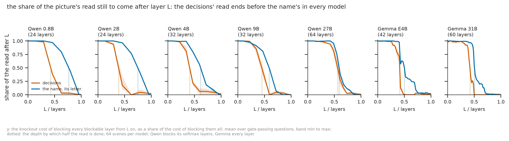
Figure: per model, the share of the picture's read still to come after layer L (the from-L-on knockout cost as a share of the all-layers cost), for the decisions (orange, mean over gate-passing questions with the band from the smallest to the largest) and the name and its first letter (blue); dotted, the depth by which half the read is done. 64 scenes per model. Source: this work, jspace-horizons/runs/run7k and run7ka, jspace-horizons/runs/figures/figAccess.csv.

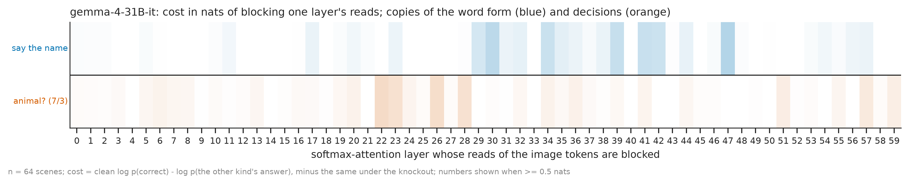
Figure: the cost in nats of blocking one layer's attention from the question to the image tokens, every layer of Gemma-4-31B; no single layer reaches half a nat. 64 scenes. Source: this work, jspace-horizons/runs/run7ka/gemma-4-31B-it.

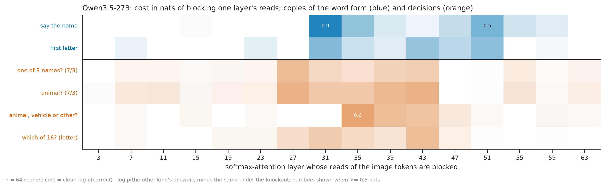
Figure: the cost in nats of blocking one softmax layer's attention from the question to the image tokens, every question at every softmax layer; no single layer reaches a nat. Qwen3.5-27B, 64 scenes. Source: this work, jspace-horizons/runs/run7k/Qwen3.5-27B.

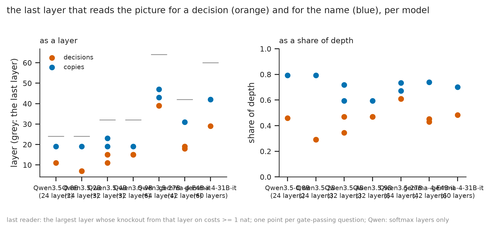
Figure: the last layer that reads the picture for a decision (orange) and for the name (blue), per model, as a layer and as a share of depth; one point per gate-passing question. Source: this work, jspace-horizons/runs/run7k.

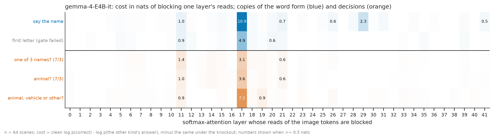
Figure: the cost in nats of blocking one layer's attention from the question to the image tokens, every question at every layer; copies above the line, decisions below. Gemma-4-E4B, 64 scenes. Source: this work, jspace-horizons/runs/run7k/gemma-4-E4B-it.

Done since: the answer-held source test on Gemma-4-E4B by knockout (row 132, above). Not run: the E4B source report by interchange, dropped because the name does not transfer on E4B (row 127) and the test could not have been scored, as on the 27B (row 122). Also not run: the 27B head-level knockout (stopped to give the card to the 31B) and a wider 27B interchange over layers 27 to 47. Judge re-scoring of the saved naming answers (row 77) agrees with the string score on 0.979 to 1.000 of rows and leaves every horizon unchanged.

Rubric grade, 21 October, after rows 109 to 132 (the full gate-by-gate scoring and the council pass are in share/council_full_scoring_21oct.md, with the earlier tables in RECORD.md under "Rubric self-grade"): 97 of 100 on the handoff's bar, and under the rubric's own law, which has no average, not release-ready while five gates stay RED: judge validation and human labels (CI, CII), an outside replication (CLXXXIII), an expert red team (CCXXXIX) and a blind review (CCXL). The size and family gates read as a replication with a measured boundary: two ordered reads in Qwen 0.8B to 27B and Gemma E4B and 31B, concentrated at a few layers up to 32 layers deep and on E4B, shared over many layers at 27B and 31B, with the depth and the order of the reads stable across all seven (row 131 and the access table). The decision's cross-modal interchange holds in both families (2B, 4B, E4B), the name's on the 2B only. The source-present-against-source-used gates are green on the 4B (row 110), the content-against-channel factorization is green on the 4B (rows 105 and 112), the answer-held test is green on the 4B and E4B (rows 115 and 132), and the matched-disruption test (row 129) closes the anomaly-detection and fallback-route readings of it, with the order boundary of row 130 stated in the story. Still RED: human judge labels, outside replication, red team and blind review. Earlier, 13:10: 92 of 100 on the handoff's bar. RED gates that block release under the rubric's own law: human judge labels (a blind sheet is in share/), external replication and red team, and provenance against causality as an orthogonal manipulation (the conflict experiment, queued). YELLOW: the 4B's name copy does not transfer by head outputs, one scene set and seed per experiment, which workspace property is tested is not stated in those terms, the setup section still describes the 14 October methods. Earlier grade, 21 October 09:45: correctness and identification green on the 2B and 4B (pre-registered rules, nats, two methods naming the same layers, matched scenes, every miss kept, one claim withdrawn and replaced). Mechanism green on the 2B (readers named by knockout, necessity and sufficiency separated, the content shown to be modality-free by interchange) and yellow on the 4B (sufficiency only jointly). The source report: green on the 4B (every gate met, the report moved by the channel-carrying heads with the answer held), yellow on the 2B (clean gate failed). Generality yellow (two Qwen sizes at single-layer resolution, the 0.8B held out, natural photos by patching, Gemma by knockout only). The resolution alternative is closed on the 2B and bounded on the 4B. 91 of 100 on the handoff's bar. What keeps it below 100 is human labels, an outside reproduction, an external red team, and an independent architecture at full resolution.

## Background: the lens, the workspace account and the question

A transformer processes a sequence of tokens through a stack of layers. Each token has a state, a vector of a few thousand numbers called the residual stream, that every layer reads from and writes back to. In a vision-language model a picture is turned into a block of image tokens placed before the text; the text tokens that come later (the question, then the answer) read the image tokens through attention at each layer.

The J-lens of [Gurnee et al. (2026)](https://arxiv.org/abs/2607.15495) turns a state at any layer into a ranking of words. For layer L it uses J_L, the average Jacobian of the model's last-layer state with respect to the layer-L state, fitted on text, and scores every word t by W_U J_L h, where W_U is the model's output matrix and h the state. The lens direction of a word t at layer L is the vector J_L^T W_U[t], scaled to length one: adding it to a state pushes the lens, and often the model, toward saying t. The lens part of a layer is the set of directions the lens reads most strongly, the top singular directions of W_U J_L; here it is one tenth of the width (256 of 2560 directions on the 4B). The fitted lenses come from [Neuronpedia's jacobian-lens repository](https://huggingface.co/neuronpedia/jacobian-lens); J++ is a later fit available for some models, and every test that had one used it beside the J-lens.

Gurnee et al. argue that the content this lens reads in the middle layers works as a global workspace: content there can be reported, held, and passed to later computations. [Nanda's review](https://www.lesswrong.com/posts/zFJ3ZdQwrTWE9jT5S) of that paper asks how far the lens's readings can be trusted as a picture of what a model uses. The question here is that one, asked about pictures: when the lens reads an object's name on its image tokens, is that the content the model reasons with?

## Setup

Six models were used, all instruction-tuned, all with fitted lenses.

| model | layers | width | lens | notes |
|---|---|---|---|---|
| Qwen3.5-0.8B | 24 | 1024 | J and J++ | fails the gate for rules on pictures |
| Qwen3.5-2B | 24 | 2048 | J and J++ | |
| Qwen3.5-4B | 32 | 2560 | J | the main model |
| Qwen3.5-9B | 32 | 4096 | J++ | knockout on 21 October (row 131); weights staged in memory, the volume being at quota |
| Qwen3.5-27B | 64 | 5120 | J | knockout on 21 October (row 120); the 14 October patching runs crashed |
| Gemma-4-E4B | 42 | 2560 | J | its last 18 layers reuse earlier keys and values |
| Gemma-4-31B | 60 | 5376 | J and J++ | knockouts on 21 October: every third layer and the ten global layers cost nothing (rows 123, 124); with every layer blockable, two spread reads ending at 0.48 and 0.70 (row 128) |

In Qwen3.5 only every fourth layer is standard attention; the other three are linear attention, which reads earlier tokens through a running memory. Gemma-4 alternates local attention with a global layer every sixth.

The stimuli are canvases of six numbered slots, three by two, each slot 224 pixels square. One slot holds a crop of a single object from [COCO](https://arxiv.org/abs/1405.0312), drawn from 16 classes with one-token names (dog, cat, bird, horse, car, bus, train, bicycle, airplane, boat, chair, clock, cup, bed, pizza, laptop). A crop was kept only if the model named it correctly on its own. On Qwen each slot covers exactly 49 image tokens, so the tokens of the object are known. The later runs use a fresh set of crops, the next 12 per class in the same shuffle, which no earlier run touched; their COCO image ids are saved with the results. The same object also appears as its name printed in the slot (the printed word) and as the sentence "Image slot q contains a dog" with no picture (the typed sentence).

The model is asked about the slot in separate prompts:

1. say: "What is the object in image slot q? Reply with the noun only."
2. letter: the first letter of its name.
3. animal: "if the object in image slot q is an animal, answer 7; otherwise answer 3."
4. ride: the same for "something people ride or drive".
5. set: "if the object in image slot q is a cat, a cup or a horse, answer 7; otherwise answer 3", with a random set of three names per scene.

The rules answer with a digit, so the answer never contains the name. Answers are scored by their first word or first character; on natural photos a Gemini judge scored them, and 40 of its verdicts were checked by a second reader, an AI assistant and not a person (40 agreed); human labels are still to be given.

The interventions go by their usual names; RECORD.md calls the first three removal, injection and transplant. Directional ablation removes a direction or a set of directions from a state, replacing it with zero or with its average over images. Activation steering adds a word's lens direction to a state at a dose measured in units of the typical size of a token's own-name component. Residual-stream activation patching ([Heimersheim and Nanda (2024)](https://arxiv.org/abs/2404.15255)) runs a donor (the canvas with object X in slot q, under a neutral prompt and no question), records its image-token states, and patches some of them into a receiver that sees object Z of the other kind in the same slot and is asked one of the questions; patching only some directions of the state is subspace patching. Window patching replaces the receiver's states with the donor's at four consecutive layers only and slides the window from the input to the last layer; whatever is patched in at a layer is then processed by the receiver's own later layers. Back-patching, after [Biran et al. (2024)](https://arxiv.org/abs/2406.12775), patches states recorded at later layers into earlier ones, here from the donor run into the receiver, and restoration patches the receiver's own clean states back in.

Each test uses 64 scenes. Intervals are 95% bootstraps over scenes. Every test has a rule, a threshold and a prediction written in RECORD.md before it ran; misses are kept as misses.

## Steering the picture with a name

Activation steering adds another object's name direction (Y, chosen from the other kind, with a different first letter) to the 4B's image tokens at the middle layers, at doses 1, 2, 4 and 8. The dose for each site was picked on 16 calibration scenes as the smallest that made the model name Y on half of them, and the verdicts were read on the other 48.

On every image token at dose 4 the model names Y on 0.88 of scenes and gives Y's first letter on 0.59 (0.80 at dose 8). The animal rule still follows the picture on 0.94 at every dose, and the ride rule on 0.91 at dose 4 and 0.70 at dose 8. A random direction of the same size changes nothing at any dose (0.00). Y's plain output direction, with no Jacobian, changes nothing at dose 4 (0.02) and names Y on 0.22 at dose 8, so the effect on the picture belongs to the lens direction. A name of the same kind as the object (Z) changes naming the same way (0.91) and the rules stay put (0.03). At the matched dose on the held-out scenes, the rules follow Y on 0.06 [0.02, 0.11] against 0.04 for a random direction.

Added at the answer position instead, the same direction names Y on 0.98, the rules again do not change (0.05), and the plain output direction names Y on 0.80, so at that position it acts as a push on the next word. On an empty canvas, the object's own name direction makes the model name an object that is not there on 1.00 of scenes and leaves both rules at chance. The 2B behaves the same (names Y on 0.97 at dose 4, rules unmoved, random 0.00, output direction 0.02), except that it does not spell the steering name (0.08). I predicted the rules would follow the steering name on 0.4 to 0.6 of scenes; they followed it on 0.06.

Ablating the object's own name direction from its 49 tokens costs 0.09 nats [0.05, 0.14] on naming and nothing on the rules. On an isolated object that one direction is not needed for anything.

## Patching part of the state into a model that sees something else

Here the receiver sees its own object, so the patched part has to win against it. The table gives the 4B on the fresh crops, the confirmation run; parts are patched at the middle layers (subspace patching).

| patched at the middle layers | names X | X's first letter | animal rule follows X | ride rule follows X |
|---|---|---|---|---|
| nothing | 0.00 | 0.02 | 0.05 | 0.05 |
| the whole state | 0.91 [0.83, 0.97] | 1.00 | 0.86 [0.77, 0.94] | 0.77 [0.66, 0.86] |
| the lens part, 256 directions | 0.84 [0.75, 0.92] | 0.92 | 0.11 [0.05, 0.19] | 0.47 [0.34, 0.59] |
| its complement, 2304 directions | 0.84 [0.75, 0.92] | 1.00 | 0.17 [0.08, 0.27] | 0.20 [0.11, 0.30] |
| a random part, 256 (three draws) | 0.36 to 0.41 | 0.31 to 0.45 | 0.05 | 0.05 to 0.08 |
| a donor that saw an empty canvas | 0.00 | 0.23 | 0.50 | 0.62 |
| the fact typed as text | 1.00 | 1.00 | 1.00 | 1.00 |

Per scene, the receiver names X and gives Z's answer to the animal rule on 0.75 [0.64, 0.86] with the lens part patched, 0.75 with the complement, 0.09 [0.03, 0.17] with the whole state and 0.34 with a random part. Asked for the digit and then the noun in one answer, it writes Z's digit with X's name (for example "7 train", an animal that is a train) on 0.50 [0.38, 0.62] with the lens part, 0.61 with the complement and 0.08 with the whole state. Patched at every layer, every part carries all four answers (0.88 to 1.00). An earlier run on the old crops gave the same pattern (lens part 0.95 and 0.09, complement 0.98 and 0.14, whole state 1.00 and 0.78).

On the 2B the lens part carries the name (0.73 [0.61, 0.83]; J++ part 0.88; random about 0.08) and nothing patched at the middle layers carries the animal rule, the whole state included (0.14); patched at every layer it does (0.94). On Gemma-4-31B the lens part carries both (0.95 and 0.97), the J++ part both (0.97 and 0.97), the complement both, and a random part neither (0.00 on naming, chance on the rule). The depth law below explains both: on the 2B the middle layers start after the fact has been read, and on Gemma-31B they start before it.

A sweep over the size of the patched part on the 4B, with no rule attached, shows the same split by rank. At 16 and 64 directions nothing changes. At 256 the lens part carries the name (0.84) and leaves the rule (0.11). At 1024 the lens-ordered part carries both (0.91 and 0.78), while a random part of 1024 carries the name (0.91) and leaves the rule (0.05).

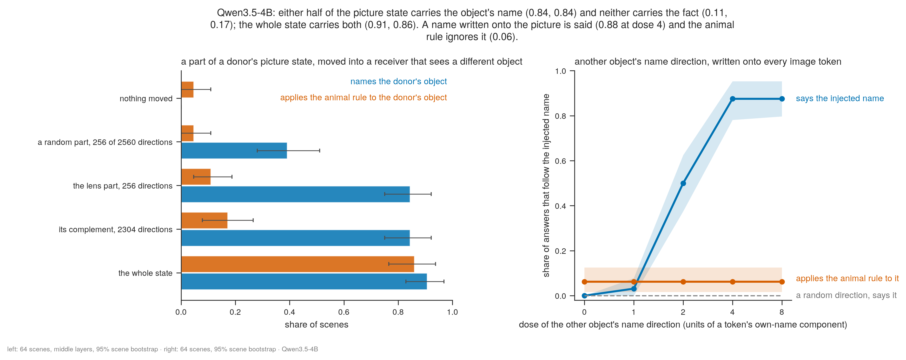
Figure: left, a part of a donor's picture state patched into a receiver that sees a different object, with the share of 64 scenes on which the receiver then names the donor's object (blue) and applies the animal rule to it (orange); right, the model's own picture steered with another object's name direction on every image token at rising dose, with the share of 64 scenes on which the model says that name (blue) and applies the animal rule to it (orange), and a random direction dashed. Qwen3.5-4B, fresh crops, 95% scene bootstrap. Source: this work, runs/run4 and runs/run3.

## The depth law

The donor's full state is patched into the receiver at one window of four layers, and the window slides from the input to the last layer. On the 4B the receiver names the donor's object on 0.83 to 0.94 of scenes for every window starting at layer 19 or earlier, 0.23 at the window starting at 23 and 0.00 after; it applies the animal rule to the donor's object on 0.94 to 0.95 for the windows starting at the input, layer 3 and layer 7, and on 0.05 from the window starting at 11. Each profile was fitted with a falling step in depth, and the horizon is where the step falls; intervals come from bootstrapping scenes.

| model | input | fact horizon | name horizon | gap |
|---|---|---|---|---|
| Qwen3.5-4B | photo | 0.32 [0.30, 0.34] | 0.71 [0.69, 0.73] | 0.39 |
| Qwen3.5-4B | printed word | 0.32 [0.29, 0.34] | 0.70 [0.68, 0.72] | 0.38 |
| Qwen3.5-4B | typed sentence | 0.26 [0.26, 0.27] | 0.67 [0.65, 0.69] | 0.41 |
| Qwen3.5-2B | photo | 0.29 [0.29, 0.29] | 0.72 [0.70, 0.77] | 0.43 |
| Qwen3.5-2B | printed word | 0.33 [0.09, 0.36] | 0.71 [0.70, 0.75] | 0.38 |
| Qwen3.5-2B | typed sentence | 0.28 [0.25, 0.33] | 0.75 [0.75, 0.75] | 0.47 |
| Qwen3.5-0.8B | typed sentence | 0.31 [0.20, 0.42] | 0.75 [0.75, 0.75] | 0.44 |
| Gemma-4-31B | photo | 0.48 [0.48, 0.49] | 0.69 [0.68, 0.70] | 0.21 |
| Gemma-4-31B | printed word | 0.47 [0.47, 0.48] | 0.70 [0.68, 0.72] | 0.23 |
| Gemma-4-31B | typed sentence | 0.47 [0.47, 0.48] | 0.74 [0.73, 0.74] | 0.26 |
| Gemma-4-E4B | photo | 0.44 [0.40, 0.44] | 0.54 | 0.10 |
| Gemma-4-E4B | printed word | 0.39 | 0.53 | 0.14 |
| Gemma-4-E4B | typed sentence | 0.38 | 0.54 | 0.16 |

Each read stops within one or two layers. Within a model the three inputs agree within 0.06. Between models of one family the horizons hold as a share of depth: the 2B (24 layers) and the 4B (32 layers) stop reading the fact at 0.29 and 0.32 and the name at 0.72 and 0.71, which are layers 7 and 10, and 17 and 23, in absolute terms. Steering a single four-layer window with a name direction changes nothing at any depth, and steering the middle layers with the lens direction of the word "animal" changes the animal rule on 0.05 of scenes, the same as a random direction, so the rule reads features of the object, and adding the category word does nothing.

Gemma-4-E4B is the exception for the name, and its configuration accounts for it, which I found after the run. Its last 18 layers reuse the keys and values of an earlier layer, so no position can read an image token's state after layer 23, and 24 of 42 layers is 0.57 of depth; its name horizon of 0.54 sits at that limit, and its two horizons are one window apart, which the frozen rule scores as "together". Leaving E4B aside, the name horizon is 0.67 to 0.75 in every model. The fact horizon depends on the family, near 0.3 in Qwen and 0.4 to 0.48 in Gemma.

The layers the lens is usually read at start at about 0.31 of depth in every model (layers 9 to 29 on the 4B, 18 to 58 on the 31B). In Qwen that is where the fact horizon sits, so a state patched there carries the name and almost none of the fact, which is the patching result above; in Gemma-31B the read layers start before its fact horizon, so there the lens part carries the fact too.

## Which questions read early

Three more questions were added to the depth sweep on the 4B. Saying the name and giving its first letter read the object until the window starting at 19, for the photo, the printed word and the typed sentence. Every rule reads it only until the window starting at 7: the animal rule (0.95 at 7, 0.00 at 11), the ride rule (0.86, then 0.08) and the set rule about the name (0.58, then 0.03). I predicted that the set rule, which needs only the name, would read late like the name; it reads early like the other rules. So the early cutoff is where questions that apply a rule stop reading, and the late cutoff is where producing the name stops reading.

An earlier run on the 4B had asked the set rule after patching the lens part at the middle layers: it followed the donor's object on 0.39 of scenes (whole state 0.53, random part 0.02), while the animal rule followed it on 0.05. The difference, 0.34 [0.23, 0.45], passed its preregistered test. With the depth sweep in hand this reads as a name arriving inside the rules' window, since the middle layers on the 4B begin at layer 9, before the cutoff at about 10.

## The fact is still there after the model stops reading it

If the late state only lacks a reader, the same vectors back-patched into earlier layers should be used, and a classifier should find the fact in them. Both hold. On the 4B, the donor's state from layers 11 to 14, patched at layers 11 to 14, makes the receiver name the donor's object on 0.88 of scenes and apply the animal rule to it on 0.05. The same vectors back-patched into layers 7 to 10 make it apply the rule on 0.91 [0.83, 0.97] and name it on 0.95, the same as the donor's own state from layers 7 to 10 patched in place (0.94 and 0.91). The donor's state from layers 7 to 10 patched at layers 11 to 14 gives 0.89 and 0.05. The layer the vectors are patched into decides whether the fact is used; the layer they were taken from does not. A nearest-centroid classifier, trained with one scene left out each time on the averaged state of the object's tokens, decodes animal against not on 0.89 to 0.97 of scenes at every layer from the input to the last.

The reverse follows from the same timing. With the donor's state patched into the early layers and the receiver's own state restored in layers 11 to 22, the receiver names its own object on 0.92 [0.86, 0.98] and applies the animal rule to the donor's on 0.95 [0.89, 1.00]; with the donor's state only in layers 11 to 22 it does the mirror image (0.88 and 0.95). The 2B repeats all of it: the late state back-patched early is used on 0.91 against 0.14 in place, and the restoration arm names the receiver's own object on 0.89 while classifying the donor's on 0.94. The same test with a four-frame video donor failed its own check (the early state patched in place changed the rule on 0.16), so video is not tested.

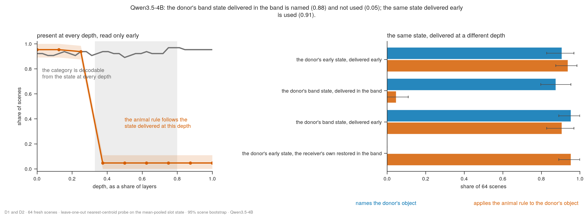
Figure: left, the share of 64 scenes on which the animal rule follows the donor's state patched at each depth (orange) against the share on which a leave-one-out classifier decodes the category from the donor's state at that depth (grey), with the lens's read layers shaded; right, what the receiver does with the donor's state by where it is patched, naming the donor's object (blue) and applying the animal rule to it (orange). Qwen3.5-4B, 95% scene bootstrap. Source: this work, runs/run5.

## Where the lens first sees the name

The conclusion this section drew on 14 October, that the lens first sees the name after the model has stopped reading it for the rules, is withdrawn (row 81 and "The lens, corrected" above). The measurements stand as what they are: the first layer at which the name enters the top ten of the pooled J-lens reading on a one-object canvas. Read token by token, or with the J++ lens, the name is visible from the input or from layer 2, so the onsets below are a property of the pooling and of the J-lens's weakness in early layers. The section is kept for the record and no claim rests on it.

The read layers above are a convention. To see where the lens itself starts to work, one crop was placed on a one-slot canvas, the state of its image tokens was averaged at every layer, and the lens ranked the object's name; the onset is the first layer at which the name is in the lens's top ten on half the scenes or more. 64 fresh crops per model.

| model | lens onset | name horizon | fact horizon |
|---|---|---|---|
| Qwen3.5-0.8B | 0.83 | 0.71 | (no picture result) |
| Qwen3.5-2B | 0.71 | 0.72 | 0.29 |
| Qwen3.5-4B | 0.75 | 0.71 | 0.32 |
| Gemma-4-31B | 0.78 | 0.69 | 0.48 |
| Gemma-4-E4B | never (at most 0.14 of scenes) | 0.54 | 0.40 |

On the 4B the lens finds the name on 6% of scenes or fewer through layers 8 to 21, then on 33%, 50% and 69% at layers 22 to 24. The plain logit lens (the output matrix applied to the state, no Jacobian) never reaches half at any layer in any model. In four models the onset is at or after the name horizon, within one layer on the 2B (0.71 against 0.72); in E4B the lens never finds the name. The frozen rule, that the onset falls after the fact horizon in at least four of the five models, holds. Before the Gemma runs I predicted, from the idea that an image token stops being trained once no later layer reads it, that E4B's onset would fall at 0.57 of depth, where its reading stops. It does not occur at all, so that idea is not supported. The onsets sit close to the threshold in every model (the share at the onset layer is 0.50 to 0.55), the 31B's is a single layer that reaches 0.52 and falls back to 0.44, and they were measured on averaged tokens of a one-object canvas, while the horizons come from six-slot canvases by patching.

## Natural photos and a width law

On natural photos from [GQA](https://arxiv.org/abs/1902.09506) (48 images held out from a pilot, three questions each, judged answers), ablating the lens part of every image token at the middle layers costs the 4B 1.41 nats [1.06, 1.75] more than ablating a random part of the same size, and the 2B 1.63 [1.22, 2.02]; the result survives mean-ablation, which replaces the part with its average instead of zero, and it grows with the length of the question's program (0.4, 1.8 and 2.3 nats on the 4B for 2, 3 and 4 or more steps). On Qwen3.5-27B the lens part is no more necessary than a random part (0.07 [−0.09, 0.21]).

The single lens direction of the answer word stays necessary at every size, while its cost falls with size.

| model | cost of ablating the answer word's direction (nats) | width | cost × width |
|---|---|---|---|
| Qwen3.5-0.8B | 2.37 [2.00, 2.81] | 1024 | 2427 |
| Qwen3.5-2B (held out) | 1.34 [1.08, 1.64] | 2048 | 2744 |
| Qwen3.5-4B | 0.98 [0.78, 1.19] | 2560 | 2509 |
| Qwen3.5-27B | 0.56 [0.43, 0.72] | 5120 | 2867 |
| Gemma-4-E4B (held out) | 2.58 [1.73, 3.67] | 2560 | 6605 |
| Gemma-4-31B | 1.39 [1.03, 1.76] | 5376 | 7473 |

Another word's direction costs 0.00 to 0.03 nats in every model except E4B (0.28). Within Qwen, cost times width is nearly constant, so the cost of one name direction falls as one over the width: a wider model spreads an object's name over proportionally more directions. The 2B's cost was predicted from the other three before it was run (1.02 to 1.52 nats) and measured 1.34. That test is clean for the 0.8B, 2B and 4B, which ablate the direction at the same share of their layers (a third); the 27B and both Gemma models ablate it at only 15 to 24% of their layers, so their points do not test the law, and the E4B prediction (2.33 to 3.50, measured 2.58) came with a wide interval. The constant differs between the families by a factor of about 2.7.

## Clutter

The cost of ablating the object's own name direction grows with the number of objects on the canvas. With 1, 2, 4 and 6 objects it is 0.07, 0.16, 0.22 and 0.33 nats on the 4B and 0.21, 0.34, 0.46 and 0.55 on the 2B, about linear in the logarithm of the count; another name's direction and a random direction cost within 0.02 at every count, and the animal rule costs 0.00 at every count on both sizes. The preregistered threshold for a load effect, 0.4 nats between six objects and one, was not met (0.27 [0.15, 0.42] and 0.34 [0.22, 0.47]), so by the rule this is undetermined.

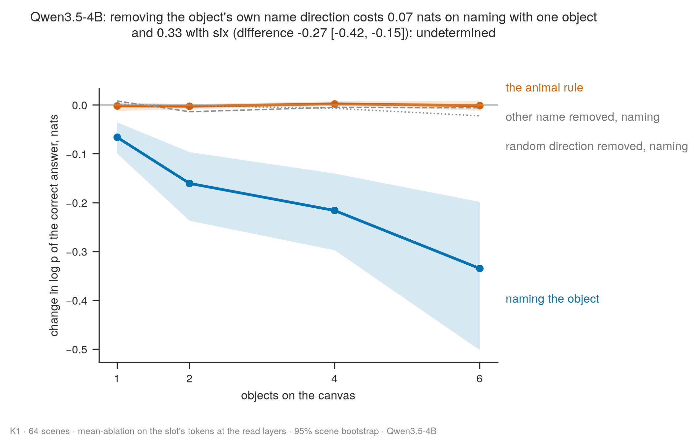
Figure: the change in log probability of the correct answer when the object's own name direction is ablated from its tokens, against the number of objects on the canvas, for naming (blue) and the animal rule (orange), with another name's direction and a random direction in grey; Qwen3.5-4B, 64 scenes, 95% scene bootstrap. Source: this work, runs/run4.

## Earlier results, kept as observations

- Patching the lens part of one canvas into another with a different object makes the 4B name the new object on 0.91 of 64 pairs; a random part 0.28; the complement 0.94.
- On a crop with another object's name printed across it, the 4B reads the word on 0.69 of items, and ablating that word's single lens direction returns it to the object on 0.28 [0.17, 0.41] more. On photos with a hand-written note ([SCAM](https://arxiv.org/abs/2504.04893)) it follows the note on only 0.19 although the note word is readable on 0.98, and steering the note-free twin with the note word's direction makes it say the note on 0.61 [0.48, 0.72]. Both replicate on the 2B. This is Debanshu's swap with controls and a dose, next to the text-overlay effects of [When Text Hijacks Vision (2026)](https://arxiv.org/abs/2604.17375).
- At the position where the model is about to answer, the lens ranks of two competing names predict which one it says: AUROC 0.78 [0.66, 0.88] on the printed-word crops and 0.90 [0.80, 0.97] on SCAM. On the image tokens both names rank first on nearly every item.
- Asked where its answer came from, the model says "writing" on all items where it followed the word and on 0.65 of items where it named the object (AUROC 0.68), so its report leans to "writing" and does not track its source.
- Printed words depend on the lens part more than photos or typed words do (0.92, 0.65 and 0.55 of each rendering's contribution on the 4B). [Steinberg and Gal (2026)](https://arxiv.org/abs/2602.22918) find a one-dimensional reading direction in Qwen3-VL; whether it is the same direction is not known.
- Patching the question tokens carries nothing of the scene into a later answer (0.00), and patching the scene tokens carries all of it (1.00): later questions read the picture again.
- The model's free description of a photo leaves out 63% [51, 75] of the facts it states correctly when asked one at a time.

## What these methods can and cannot show

Every causal result here comes from patching, steering or ablating the residual stream of the image tokens and reading the answer. That shows which information, at which tokens and which depth, the answer depends on: if the answer changes, something later reads that state. The converse is weaker: an unchanged answer says only that nothing downstream needed the blocked or patched state for that answer, because a redundant pathway, a compensating one, a saturated answer or an insensitive score can hide a contribution. Two cases here show the gap: on Gemma-31B the first two knockout grids cost nothing while the every-layer arm costs 31 nats (rows 123, 124 and 128), and on the 2B the decision station's heads are necessary but not sufficient alone because the read is redundant across layers 7, 11 and the linear layers (row 97). Every null is therefore reported as a null of the stated intervention, with the all-layers arm as the reference. Which heads do the reading is shown by the 21 October knockouts and head-output patches (rows 85, 92, 97, 99 and 101), with the attention knockout [Geva et al. (2023)](https://arxiv.org/abs/2304.14767) used to find where attributes are extracted, and with per-head output patching. In Qwen3.5 the knockout applies only to the one layer in four that uses softmax attention, so the linear-attention layers' share of a read is measured by what remains when every softmax layer is blocked.

Several arms build states a model never meets in normal use, such as the receiver's early layers under the donor's later ones. A reviewer can call the contradiction (naming one object and classifying another) a product of those mixed states. Two results answer part of that: the single steering direction gives the same split without mixing two states, and in the restoration arm each stretch of layers holds a coherent state of one model run. The natural-photo tests of 21 October answer part of it: the GQA knockout involves no patching, and the GQA blank-image patch builds the mixed state again, so the stations on photos rest on the knockout's accuracy profiles and on the patch together (rows 87 to 91, 96).

The lens onset depends on the threshold (top ten on half the scenes) and on averaging the object's tokens; reading each token separately can find the name earlier on some tokens.

## What is new against the closest work

[Geva et al. (2023)](https://arxiv.org/abs/2304.14767) showed in text that a subject's attributes are written into its token in early and middle layers and extracted at the last position. Biran et al. (2024) showed that a two-step question fails when the first step resolves too late in the network for the second to use it, and that back-patching the later state into an earlier layer repairs up to 66% of those failures; the back-patching test here is the same operation, made across runs on image tokens. [Cohen, Gottesman, Geva and Giryes (2024)](https://arxiv.org/abs/2412.14133) showed that vision-language models resolve a pictured entity late and answer factual questions about it up to 18% less accurately than about the same entity named in text. Those papers locate where information is written. The measurements here give the depths at which it is read, by patching state and reading the answer with no probe, and add four things the papers we read do not have: the read depths are the same for a photo, a printed word and a typed sentence; every rule reads early and only naming reads late; back-patching across runs separates the two reads, so a state can be named without being used and one answer can name one object while classifying another; and the name is visible to a lens on the image tokens at every depth while it is read at two stations, so a lens reading says nothing about when it is used. [Nikankin, Arad, Gandelsman and Belinkov (2025)](https://arxiv.org/abs/2506.09047) report modality-specific circuits for the same task in text and pictures, with the components that process the data tokens separate by modality and the query and generation components swappable between them. Here the readers are named at the head level, their outputs recorded in one modality and written into the other carry the object's sixteen-way identity, and the report of the channel follows which heads delivered it, on one size at the head level. [Salazar, Frank, Oneata, Elliott and Fierro (2026)](https://arxiv.org/abs/2607.03358) find by causal patching two routes for visual information in vision-language models, a direct one in which the final token reads the image tokens and a text-mediated one in which the question's tokens read them first, with the route set by the task and the prompt and a fallback to the text-mediated route when the direct one is ablated. The query-token result here (row 109) is a consumer-level version of that split: a decision reads the picture through the question's tokens and never through the answer position, the name reads it at the answer position, and the two reads close at different depths. What is added is the depth of each route, the identity of its readers, and that a typed word takes the same routes. Johnson, Hashtroudi and Lindsay (1993) describe source monitoring in people as an inference over cues, and [Ranjan, Sokratous and Odegaard (2026)](https://arxiv.org/abs/2607.23927) measure source attribution in language models behaviourally, self-generated against user-supplied content, and find it depends on how the conversation is stored. Here the model's source report follows which heads delivered the content, a model given only the content-carrying heads misattributes a read word to the picture, and with the answer held the report follows the pathway that carried it (row 115). [Singh, Linzen and Ravfogel (2026)](https://arxiv.org/abs/2605.26242) show that a model's reports of tampering with its own state can be explained by anomaly detection without any access to the cause. That objection applies to row 115, where blocking the picture's reads also removes the picture's evidence at the question's tokens, and the matched-disruption test (R23, in Loose ends) is the one that separates the two readings.

## The theory, labelled as such

A token's state is read by later positions only within a window of depth for each purpose, and content still in the state after its window has closed has no further effect on that purpose. The windows are ordered the same way in every model tested, from 0.8B to 31B in two families: the decisions' window closes before the name's. How the reads inside a window are organized changes with size. Up to 32 layers deep, and on Gemma E4B, each window is a station of a few readers (on the 2B, two heads at one softmax layer for the decisions and three layers for the name). On the 27B and the 31B the same two windows are shared over fifteen to twenty layers with no single layer carrying a nat (rows 120 and 128), while their position in depth and their order are those of the smaller models (the access table). Within a model the windows sit at the same depths for a photo, a printed word and a typed sentence, and what the readers deliver is the object, with the channel carried by other heads at the middle layers and absent from the name station's output by the measures used. The mechanism is architectural in one sense: a state patched in after the last layer that reads it cannot affect anything. The finding is where those windows sit and what that placement does: the fact stays decodable and usable long after the decisions' window has closed, and a lens, which shows the name at every depth, cannot say when it is used. The earlier form of this paragraph, which stated two heads at one early station as the theory, described the small models; the 27B result (row 120) is what scoped it, and the 14 October sections below keep that description for the models it fits.

The theory has survived tests whose outcome was not known in advance: a state patched between the horizons carries the name without the fact, on two Qwen sizes; a name direction added there by steering is said while the rules barely change; the same late state back-patched earlier is used; the restoration arm makes the model classify one object and name another; the horizons hold across three input types in five models. It has failed one: the idea that image tokens stop being trained after their last reader, and that this is why the lens can read them late, predicted an onset at 0.57 on E4B, and the lens never read the name there. It has failed a second: the prediction that the 27B's decisions would stop reading at the 2B's share of depth (0.29) or at its layers (11) failed, and they stop at 0.61 with no station (row 120). It names the heads on the 2B (rows 85, 99 and 101). It does not yet say why the decision station sits one softmax layer later on the 4B, or later in Gemma than in Qwen, nor why the reads sit at a few heads up to 4B and on E4B and spread over many layers at 27B and 31B.

## What failed or was withdrawn

- The original articulation bound, a capacity limit on how many items the lens holds at the answer position, was not supported: the count read there is the plan for the answer, and the question tokens carry nothing of the scene.
- The claim that the name horizon sits at 0.7 in every model was withdrawn when E4B put it at 0.54; its sharing of keys and values explains that value.
- The prediction that the horizons would order themselves by property (animal, then ride, then set, then letter, then say) was wrong: they fall into two groups.
- The idea that image tokens are untrained after their last reader failed its E4B test.
- The first patching run's positive control for the animal rule reached 0.78 against a frozen threshold of 0.8 (0.86 on the fresh crops), and the clause asking an empty-canvas donor to leave the receiver's answer in place was mis-specified (that donor erases the receiver's object, which is what it should do); both are kept as failed.
- The load threshold was missed, the video version failed its check, the 0.8B cannot apply the rules to its own pictures, and both Qwen3.5-27B patching runs crashed inside the linear-attention kernel.

## Loose ends

- Whether a lens reading predicts which natural-photo questions fail. The stations transfer to GQA by patching (rows 91 and 96), and the knockout fails its nat rule because the linear layers carry most of a photo's read. The prediction of failures from a lens reading has not been tested.
- Why Gemma's decision station is later than Qwen's. The E4B head-level run has not been done.
- Whether the width law holds when every model ablates the direction at the same share of its layers, and at 27B once its patching runs work.
- Why the 4B's pathway-tracking report exists only in the name-first order (row 130), what "read" defaults to when the channel is asked before the name, and which heads at the answer position compute the judgement (row 117 found no single head).
- Why the reads sit at a few heads up to 32 layers deep and on E4B and are shared over many layers at 27B and 31B; the 27B head-level knockout and a wider 27B interchange (layers 27 to 47) are the next runs.

## For the meeting

In Qwen3.5 and Gemma-4 an object's image tokens are read for every rule the model applies by about a third to a half of the network, and for the object's name until about two thirds, at the same depths for a photo, a printed word and typed text. The fact stays in the state after its readers have passed, and the same state back-patched into earlier layers is used again (0.91 against 0.05). A text-trained lens shows the object's name on those tokens at every depth, before, during and after the two reads, so a lens reading cannot say when the content is used. The same heads read a typed word, and what they deliver is the object without its channel: their outputs recorded while the model reads the word dog, written into the model that sees a cat, make it call the cat a dog and apply the animal rule to it. If the verbalizable content of a position can be set without the fact it names, what does a J-lens reading of a reasoning step tell us about the step?

## Examples

Each figure below shows single runs of the model: the input it received and the answers it wrote. The pictures are the inputs themselves, cut from the stimulus sheets the runs saved or, for the SCAM and GQA photos, resized with the runs' own code. The answers are copied from the runs' CSV files. The canvas examples are scenes 0 and 1, the two scenes each run saved pictures of. The photo examples were picked from the items whose answer changed, and each caption gives how often that happened. The rule questions asked for a digit, 7 for yes and 3 for no; the figures print yes and no.

The interventions are the ones defined in Setup: residual-stream patching of a donor run's image-token states into a receiver run, back-patching of later-layer states into earlier layers, restoration of the receiver's own states, activation steering with a word's J-lens direction, and directional ablation of it.

A picture question reached the 4B as this text, where the one `<|image_pad|>` stands for the canvas's 294 image tokens:

```
<|im_start|>user
Study the scene. It has an image grid with numbered slots.<|vision_start|><|image_pad|><|vision_end|>What is the object in image slot 1? Reply with the noun only.<|im_end|>
<|im_start|>assistant
<think>

</think>

```

The other questions replace the last sentence: "What is the first letter of the name of the object in image slot 1? Reply with the letter only.", "Rule: if the object in image slot 1 is an animal, answer 7; otherwise answer 3. Reply with the number only.", and the same rule for "something people ride or drive" and for "a train, a bird or a clock". The donor run gets the same first sentence and picture and no question.

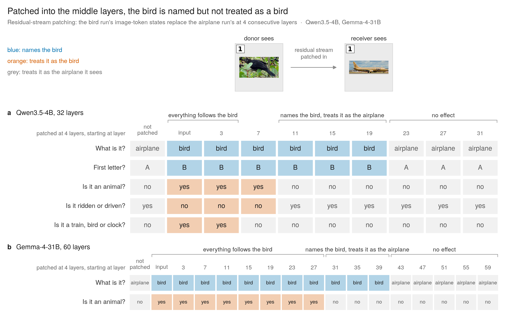
Figure: the image-token states of a donor run that saw a bird are patched into a receiver run that sees an airplane, at 4 consecutive layers only; each box is the answer to one question. Patched into the early layers, every answer is the bird's. Patched anywhere from layer 11 to 22 in Qwen3.5-4B, or 31 to 42 in Gemma-4-31B, the model still says bird but answers every rule for the airplane. The same switch shows on 58 of the 64 scenes in each model. Source: this work, runs/run5/Qwen3.5-4B and runs/run4/gemma-4-31B-it, d1_depth.csv, scene 0.

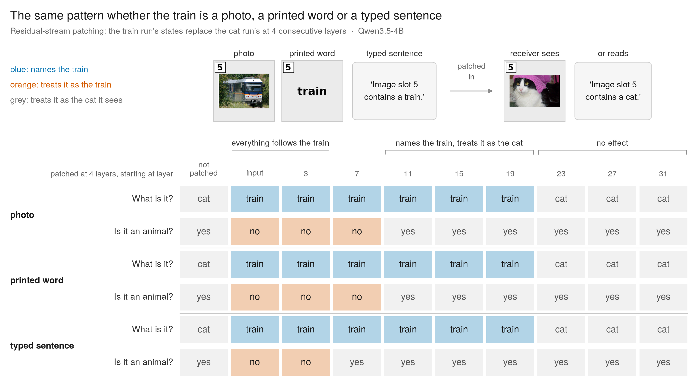
Figure: the same patching with the train given three ways: a photo, the word printed in the slot, and the typed sentence "Image slot 5 contains a train.", where only the state of the word "train" is patched, into the position of "cat", and there is no image. In all three the model names the train for patches starting up to layer 19, and treats it as a train up to layer 7 (layer 3 for the typed sentence). Source: this work, runs/run4/Qwen3.5-4B/d1_depth.csv, scene 1.

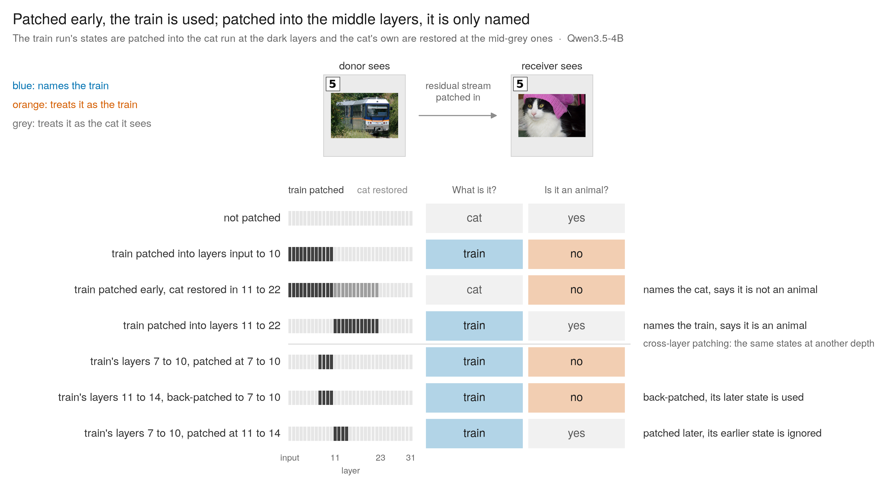
Figure: the bars show which of the receiver's layers get the train run's states (dark) and where the cat run's own states are restored (mid grey). Patched early with the cat restored in the middle, the model says cat and that it is not an animal; patched into the middle only, it says train and that it is an animal. Over the 64 scenes these two mixed answers come on 0.88 and 0.83 of scenes. The last three rows patch 4 layers of the train's states at another depth: its states from layers 11 to 14, back-patched into layers 7 to 10, are used by the animal question (0.91 of scenes), and its states from layers 7 to 10, patched into layers 11 to 14, are ignored (0.05). Biran et al. (2024) back-patched within one run of a text model to repair two-step questions; here the states come from a different run that saw a different picture. Source: this work, runs/run5/Qwen3.5-4B/d2_reverse.csv, scene 1.

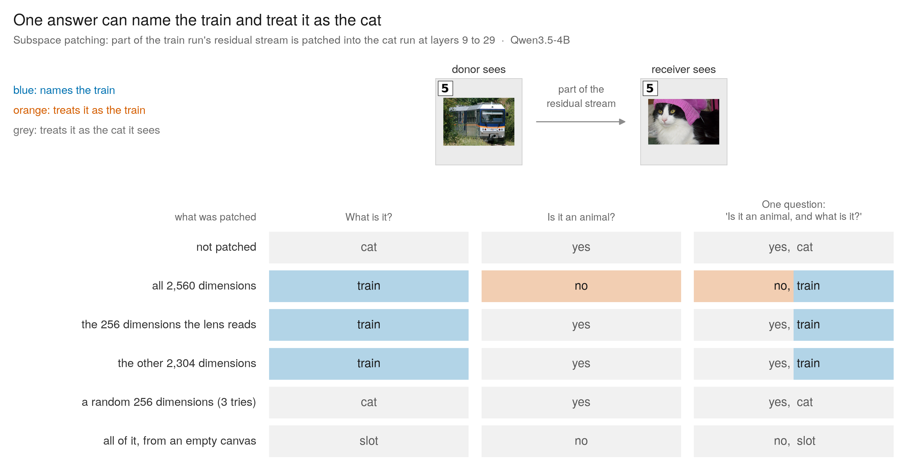
Figure: subspace patching: part of the train run's residual stream is patched into the cat run at layers 9 to 29: all of it, the 256 dimensions the J-lens reads most strongly, the other 2,304, or a random 256. Asked in one question whether it is an animal and what it is, the model answers "7. Train" with either part: an animal, and a train. Over the 64 scenes this mixed answer comes on 0.50 of scenes with the lens part, 0.61 with the other 2,304 dimensions and 0.08 with the whole state. Source: this work, runs/run4/Qwen3.5-4B/f4_name_without_fact.csv, scene 1.

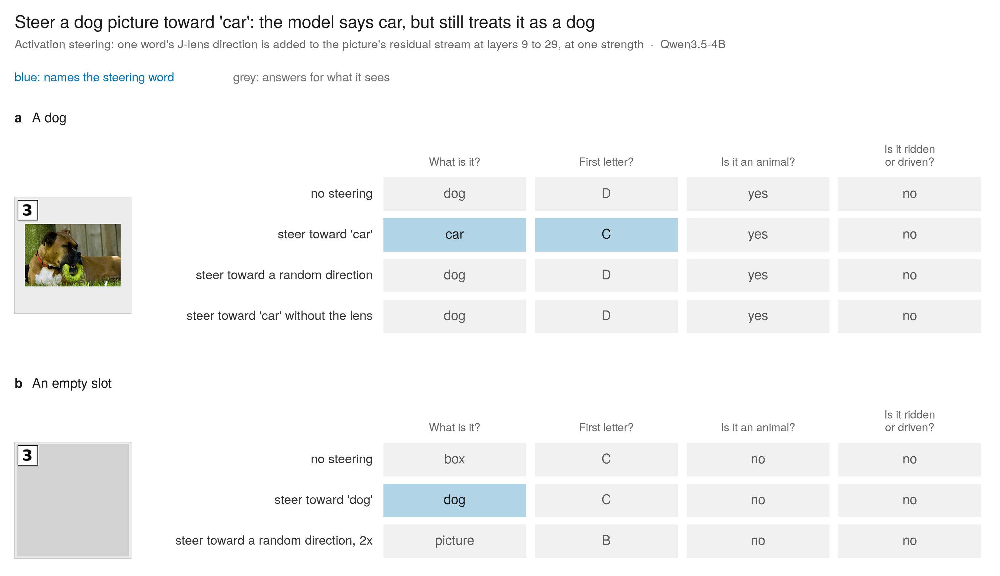
Figure: activation steering: the J-lens direction of a word is added at layers 9 to 29, to every image token of the dog picture or to the 49 tokens of an empty slot, at 4 times the typical size of a slot's own-name component (8 times for the random direction on the empty slot). Steered toward "car", the model says and spells car while both rules still answer for the dog; a random direction or car's plain output vector at the same strength changes nothing. On the empty slot, steering toward "dog" makes the model name a dog that is not there. Over 64 scenes the added name is said on 0.88 and the rules follow it on 0.06. Source: this work, runs/run3/Qwen3.5-4B/g1_handle.csv, scene 0, one of the 16 scenes the strength was chosen on.

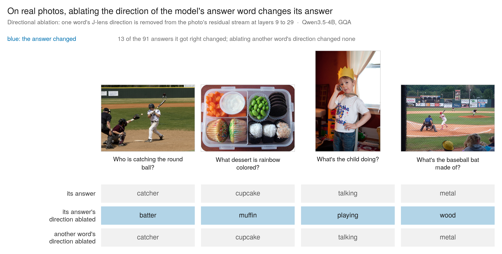
Figure: directional ablation on GQA test photos with their own questions. Ablating the J-lens direction of the model's answer word from the photo's image tokens at layers 9 to 29 changed 13 of the 91 answers it got right, these four among them; ablating another question's answer word changed none. Across all 144 questions the ablation costs the right answer 0.98 nats of log probability. Source: this work, runs/n1confirm5/Qwen3.5-4B/n1_gqa_necessity.csv.

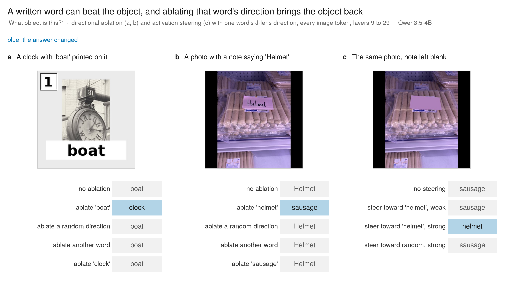
Figure: "What object is this?" for a COCO crop with another object's name printed on it, and for a SCAM photo with a hand-written note. Ablating the J-lens direction of the written word makes the model name the object; ablating a random direction, another word or the object's own word does not. Steering the same photo with the note left blank toward "helmet" makes the model say helmet at the higher strength. Over the runs the written word wins on 44 of 64 printed crops and 12 of 64 SCAM photos; ablating its direction sends 0.28 more of the printed crops back to the object, and steering the blank photos toward the note's word makes the model say it on 0.61. Source: this work, runs/run1/Qwen3.5-4B, a1_label_vs_object.csv scene 5 and a2_scam.csv item img_0706.

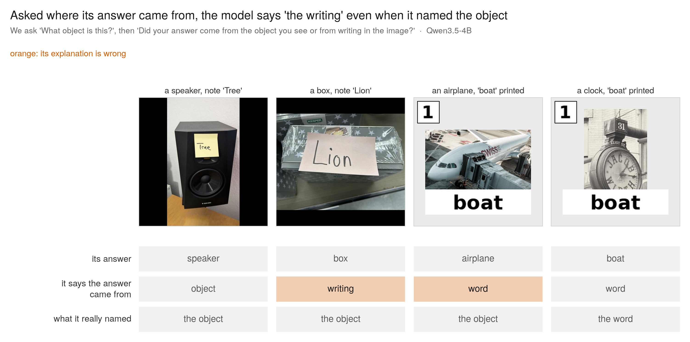
Figure: after its own answer the model is asked "Did your answer come from the object you see or from writing in the image?" ("or from the printed word?" for the printed crops). It names the box and the airplane and still says the writing. After naming the object it said writing on 31 of 51 SCAM photos and word on 13 of 20 printed crops; after following the writing it said so every time, 12 of 12 and 44 of 44. The run kept the first word of each reply. Source: this work, runs/run1/Qwen3.5-4B, a2_items.csv and a1_scenes.csv.

runs/examples/ has each figure as PNG, PDF and SVG (the SVG keeps its text editable), every input at full size, and outputs.csv, which lists each answer shown with its exact prompt, what was done inside the model, the answer as the model wrote it and the CSV row it came from. jbound/fig_examples.py rebuilds all of it from the logs.
