# Where a question stops reading the picture, at single-layer resolution

Draft for Nayan to send to Noah (21 October 2026). Every number is from jspace-horizons/runs/run7 to run14; the rules were written in RECORD.md before each run.

The result I would lead with: the model reads a picture with the circuit it reads a word with, and what that circuit delivers is the object without its channel. With the object given as the typed sentence "Image slot 3 contains a dog" and attention to the word blocked head by head, the same heads that read the picture read the word (heads 1 and 3 at layer 7 for the decisions, 4 at 11 and 5 at 19 for the name, rows 95 and 99). Then the interchange: the outputs of those heads recorded while the model reads the sentence, written into the run that sees a picture of a cat, make the model apply the animal rule to a dog on 0.98 of scenes and say "dog" on 0.95 (row 101), and at the name station the vector a head writes for a dog seen and a dog read is the same up to the object, with no component for which channel it came from. A sixteen-way identification with a letter answer still reads at the decision station (row 102), so the late read is about the word form and not about fine identity. I think the depth at which a question stops reading an object's image tokens is set by one thing: whether the answer is a decision about the object or a copy of its word form. Every decision I tried stops at one early station and every copy at one late station, whatever the question needs and whatever form the answer takes, and the two stations come out the same by patching and by attention knockout on two sizes. The lens claim from last week does not survive a better lens, so I am dropping it.

tl;dr

1. Single-layer patching with log-probabilities (your first question). The donor's image-token state is written in at the output of one layer L, so the question reads the receiver's object up to L and the donor's from L + 1. The estimand is log p(donor's answer) minus log p(receiver's answer) at the first answer token. On the 4B every decision stops at layer 9 or 10 (the read ends at softmax layer 11) and every copy at 22 (the read ends at 23); on the 2B, 6 and 18 (softmax layers 7 and 19). Eighteen questions, 64 scenes each, gate at 0.85 clean accuracy.
2. Step or slope (your second question). A decision's log-probability difference is flat from the input through layer 7 and reaches its clean value by layer 11, for example animal on the 4B: +6, +5, +3, 0, -8 nats at patches 7, 8, 9, 10, 11. A copy's falls in three steps at 19, 23 and 27 (say: +11 at 15, +7 at 19, +4 at 22, -1 at 23, -9 at 27). So both of your intuitions hold, for different reads: a decision is a few readers at one station, a copy is a sum over three softmax layers.
3. Consistency across concepts (your third question). Per scene, the animal rule's depth has a median of 9 and an interquartile range of 1 on the 4B, with 0.92 of scenes within one layer of the median (2B: median 6, IQR 0, 0.80); naming has a median of 22, IQR 2, 0.66 within one layer (2B: 18, 1, 0.94).
4. Your just-in-time hypothesis, tested as written. The rule over five names and the conjunction "animal and more than four letters" read at the same layer as the rule over one name and the plain animal rule (9 to 10 on the 4B, 6 on the 2B), and the first letter reads with the name (22 and 18), not between the name and the rules. Extra steps after the read do not move it.
5. The 2 by 2. Lexical rules with a digit answer (is it a cat; one of three or five names) read at the decision station, and category questions answered with a word ("animal, vehicle or other", "yes or no") read at the decision station too. So the station is not set by what the question needs and not by the answer's form; it is set by decision against copy.
6. The readers, by knockout. Blocking attention from the text to the image tokens at one softmax layer: on the 2B every decision loses 2 to 4 nats at layer 7 and nothing from 11 on, every copy loses 1 to 3 nats at each of 11, 15 and 19; on the 4B decisions at 7 and 11, copies at 11, 15, 19 with a tail to 23. Blocking every softmax layer leaves the copies 2 to 4 nats that the linear-attention layers carry, and the decisions nothing.
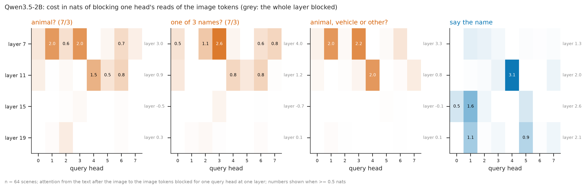
Figure: the cost in nats of blocking one query head's attention from the text to the image tokens, per head at each station layer, for three decisions and the name; grey, the whole layer blocked. Qwen3.5-2B, 64 scenes. Source: jspace-horizons/runs/run7h/Qwen3.5-2B.

7. Why a steered name is said and not used. Last week's steering wrote the name into the lens band (layers 9 to 29) and the rules ignored it. Written before the decision station instead (layers -1 to 10), the same direction at the same dose moves the rule over names on 0.48 of scenes and the animal rule on 0.23; written after it (11 to 22), on 0.03 to 0.06; said on every scene either way. My pre-registered 0.5 threshold for the decisions was not met, so this is undetermined by its rule, with the direction as predicted. On the 4B the decision station is one head, head 4 at layer 11 (1.8 nats alone); the copy read is spread over several heads there.

8. Dose. Mixing the donor in at 0.75 leaves both depths unchanged with a lower plateau (4B: 22 and 9, plateaus 9.6 and 6.3 nats against 11.8 and 7.6); at 0.5 the donor never clearly wins (plateau 0.8 and 0.1), so no depth can be read there.
9. The lens, corrected. With J++ and reading the image tokens one by one, the name is in the top ten on the pooled tokens from layer 2 of 24 on the 2B (0.52 of scenes, null 0.00) and on some token from the input with the J-lens (0.94, null 0.02). Last week's "the lens first sees the name after the model stops reading it" came from pooling and from the J-lens's weakness in early layers; withdrawn. What stands: the name is visible on the tokens at every depth, read at two stations, and a lens reading does not say when or whether it is used.
10. Scoring check. The frozen Gemini judge agrees with the first-word string score on 0.979 to 1.000 of the saved naming answers across five models, and no horizon changes.

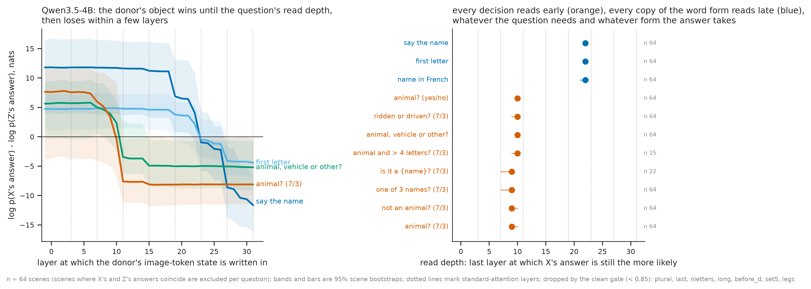
Figure: left, log p(X's answer) minus log p(Z's answer) by the layer at which the donor's state is written in, five questions, 95% scene bootstraps; right, the read depth of every question that passes the clean gate, decisions in orange, copies of the word form in blue. Qwen3.5-4B, 64 scenes. Source: jspace-horizons/runs/run7/Qwen3.5-4B.

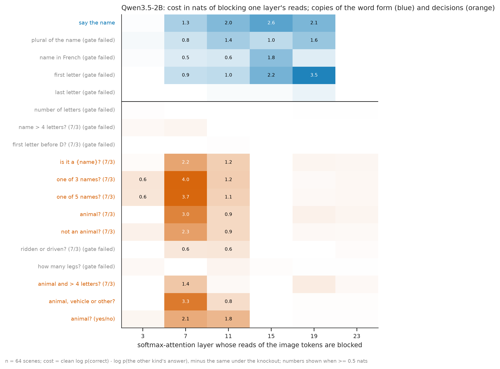
Figure: the cost in nats of blocking one softmax layer's attention from the question to the image tokens, every question at every softmax layer; copies above the line, decisions below; gate failures in grey. Qwen3.5-2B, 64 scenes. Source: jspace-horizons/runs/run7k/Qwen3.5-2B.

11. Natural photos, two outcomes. On GQA (48 photos, the benchmark's own names, attributes and yes-or-no or either-or questions, judge-scored) the knockout fails its pre-registered 1-nat rule on both sizes, because on natural photos most of the read runs through Qwen's linear-attention layers, which a mask cannot block (blocking every softmax layer leaves names at 0.46 against 0.60 clean on the 4B). The accuracy profiles show the canvas order post hoc: decisions are back at their clean accuracy once only layers 15 on are blocked (11 on the 2B), names and attributes recover only from 19 to 23. The patching version, which reaches every layer, then gave the clean result: with a blank image's token states written into the photo's tokens from layer L on, decisions are at chance (0.48 to 0.54) for every L up to 10 and at their clean 0.83 to 0.85 from L = 11, a one-layer step at the canvas decision station; names stay at 0.17 to 0.35 through 18 and are back at their clean 0.60 from 19; attributes climb from 15 to 23. The stations transfer to natural photos (row 91).

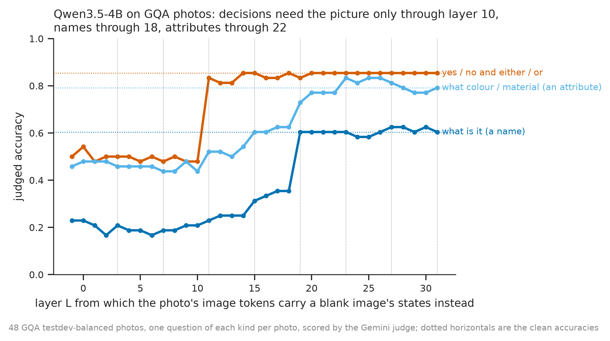
Figure: judged accuracy on GQA by the layer from which the photo's image tokens carry a blank image's states, per question kind; dotted horizontals are the clean accuracies. Qwen3.5-4B, 48 photos, 144 questions. Source: jspace-horizons/runs/run9p/Qwen3.5-4B. On CountBench (491 photos, 400 correct answers kept) the result is graded and my prediction was wrong: counts of 2 to 4 stop needing the softmax reads by layer 11 like the canvas decisions, 5 to 6 by 15, and 7 to 10 keep reading through 19 and 23 (0.51 correct with layers 15 on blocked, 0.92 only from 23). The read depth grows with the count, the opposite of just in time: a third kind of read, an accumulation over many tokens.

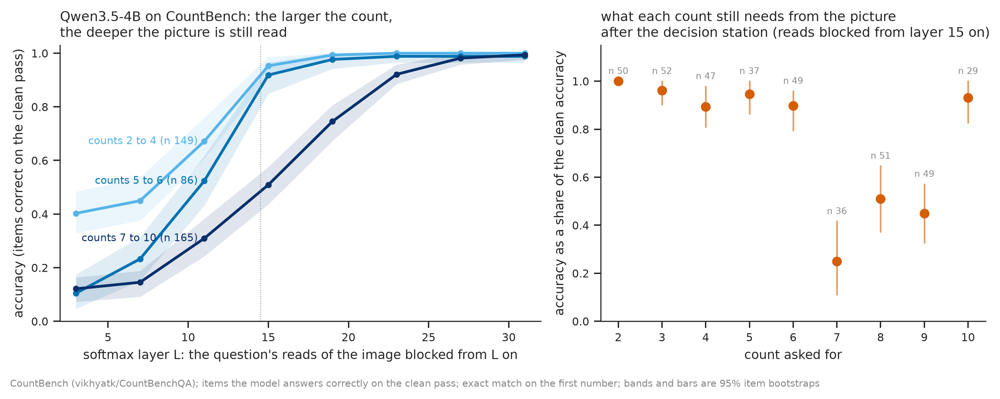
Figure: left, accuracy on CountBench by the softmax layer from which the question's reads of the image are blocked, one line per count; right, the first blocked-from layer at which each count keeps 0.9 of its clean accuracy. Qwen3.5-4B, 400 items. Source: jspace-horizons/runs/run10/Qwen3.5-4B.

12. The interchange across modalities. The donor reads "Image slot q contains a X." with no picture, the receiver sees a picture of Z with the same question, and the donor's per-head attention outputs at the question's tokens are written into the receiver. The animal rule then follows the typed word on 0.98 of scenes (all heads of layers 7 and 11, clean 0.08) and the name on 0.95 (all heads of 11, 15 and 19, clean 0.00); the reverse direction gives 0.95 and 0.41. Head 5 of layer 19 alone moves the animal rule on 0.58 from the word donor and 0.77 from a picture donor, and all heads of 7 move it on 0.47, so the decision heads are necessary (row 85) but not sufficient alone (the read is redundant across 7, 11 and the linear layers), while the late name head is sufficient for a decision it is never needed for. On the 4B, layer 19's heads from the word donor move the rule on 1.00.

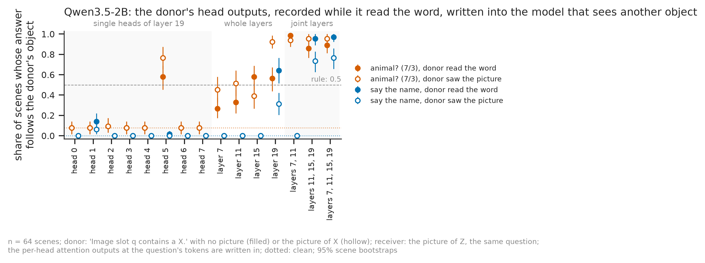
Figure: the share of scenes on which the picture receiver's answer follows the typed donor's object, for single heads of layer 19, whole layers and joint layers, with the picture donor hollow; 95% scene bootstraps. Qwen3.5-2B, 64 scenes. Source: jspace-horizons/runs/run13/Qwen3.5-2B.

13. The same vector. At layer 19, head 5's output at the answer position for a dog seen is closer to its output for a dog read than to a cat read by 0.33 in cosine, and a cat seen is no closer than a cat read (a modality component within 0.05 of zero for every head of 19). The decision heads at 7 carry the object at the question's slot token and a channel component at the answer position.

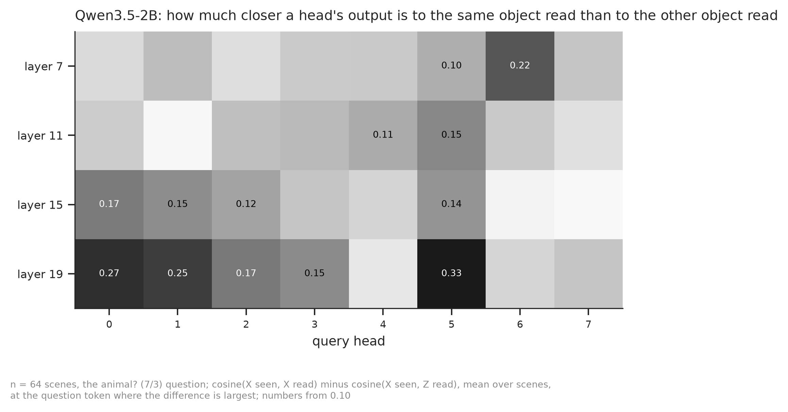
Figure: per head and layer, the cosine between a head's output for the object seen and the same object read, minus the cosine for the other object read, at the question token where the difference is largest. Qwen3.5-2B, 64 scenes. Source: jspace-horizons/runs/run13a/Qwen3.5-2B.

14. Does the model say it saw what it read? The receiver sees Z in slot q and reads a note about slot p; the donor read notes about both slots and saw no picture; the question asks for the object in slot q and whether it was seen or read. On the 4B every gate is met (clean "Z, seen" 0.89 / 1.00, control slot "W, read" 1.00, donor "X, read" 1.00). With the donor's heads at layers 19 and 23 written in, the receiver names the read dog on 0.44 of scenes and on 0.93 of those says it saw it; with layer 15's heads added it names the dog on 0.48 and says it read it on 0.81 (rows 103 and 105). On the same scenes with the name held (24 scenes name the read dog under both arms) the report goes from seen 0.92 to read 0.75, 16 scenes flip that way and none back. The object never appeared in the receiver's picture or note, so this reads the model's internal channel signal and not a real external cause. The object and its channel travel through different heads, and the report follows the channel-carrying heads. On the 2B the clean report fails its gate (seen on 0.77), the name station alone leaves the report at chance, and adding layer 11 makes it "read" on every scene.

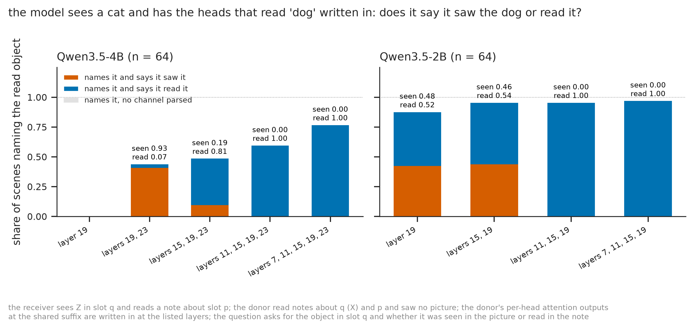
Figure: per written-in layer group, the share of scenes on which the picture receiver names the read donor's object, split by whether it reports having seen it (orange) or read it (blue). Qwen3.5-4B and 2B, 64 scenes each. Source: jspace-horizons/runs/run15 and run15b.

15. The resolution control on the 4B: the sixteen-way question reads at 11 and 15, one softmax layer later than the two-way decisions and two before the name's last reader (row 104).

16. Load against the read (row 107). The same scenes with two or five other objects in the other slots: the animal rule reads to layer 6 with five other objects exactly as with none, with the same readers, and only its margin lower (6.6 to 3.1 nats); the name's read ends one to three layers earlier (17 and 15 against 18) and its transition broadens from 6 to 9 layers, with the same readers. No read goes deeper with load, so CountBench's deeper read with larger counts belongs to counting.

17. Gemma, every layer (row 108). On Gemma-4-E4B all 42 layers can be blocked: the decisions read through layers 11 and 17 and end at 19 (0.45 of depth), the name and its letter through 17 and 29 and end at 31 (0.74); layer 17 alone costs the name 10.9 nats and the animal rule 3.6. Two stations in the second family too, twelve layers apart, with one shared layer. The knockout also explains why patching put E4B's naming depth at 23 on 14 October: its last 18 layers reuse earlier keys and values, so a patch after 23 cannot reach the reads at 29 to 31 that the knockout finds.

18. Which token reads the picture (row 109). Measured at every question token, the layer-7 heads deposit the object on the word "animal" in the rule, and the knockout restricted to that one token's reads costs the animal rule 3.3 of the 4.9 nats of the whole station, with the answer position costing nothing; for the name, blocking only the answer position's reads at the name station costs 2.8 of 4.9. A rule reads the picture through the token that names its test, and the name is read where it is about to be written.

19. Two real sources in conflict (row 110). A picture of one object and a note naming another, in the same slot. The 4B names what the picture shows (0.83) and says it saw it (0.89), so the note is present and ignored and the report is right. Block the picture's reads and it names what the note says on 1.00 and says it read it on 1.00: 53 scenes flip and the report moves with every one. Blocking the picture only at the decision station does the same; only at the name station, 52 flips and 0.96. The 2B fails the gate (it says "read" whenever a note exists). This is the source-present-against-source-used test your faithfulness work asks for, on a real external source, and on the 4B the report tracks the cause.

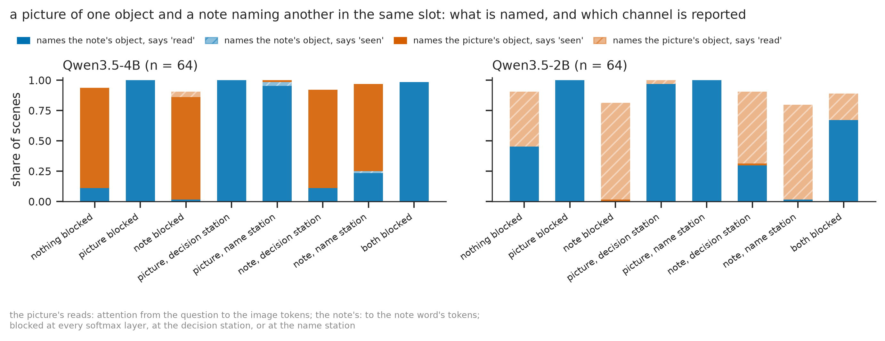
Figure: per arm, the share of scenes naming the note's object (blue) or the picture's (orange), filled when the reported channel matches the named object's channel and hatched when not. Qwen3.5-4B and 2B, 64 scenes each. Source: jspace-horizons/runs/run17.

20. Two tests an adversarial reader asked for (rows 111 and 112). The identity transfers: with the sixteen-way question as donor and receiver, the heads that read the typed word make the picture receiver give the word's letter out of sixteen on 0.92 (layers 7 and 11) and 1.00 (11, 15, 19). The channel is bound to the object: a control donor that read only a note about another slot transfers its own read object with "read" attached (37 of 64 scenes, read on 1.00) and leaves every scene that still names the picture's object saying "seen" (25 of 25); the middle layers never produce a free "read".

21. The same answer from two sources (row 115), the test I would put first in a talk. The note names the picture's own object, so the 4B answers the same word whichever source carried it, and only the pathway differs. With the picture's reads blocked at every softmax layer the report goes from "seen" to "read" on 64 of 64 scenes; with the note's blocked it stays "seen" on 62 of 62; blocking the picture at the decision station alone moves 31, at the name station alone 2. Same picture, same note, same answer, and the model reports which pathway delivered it. On the 2B the report is a format inference and this test is not scored.

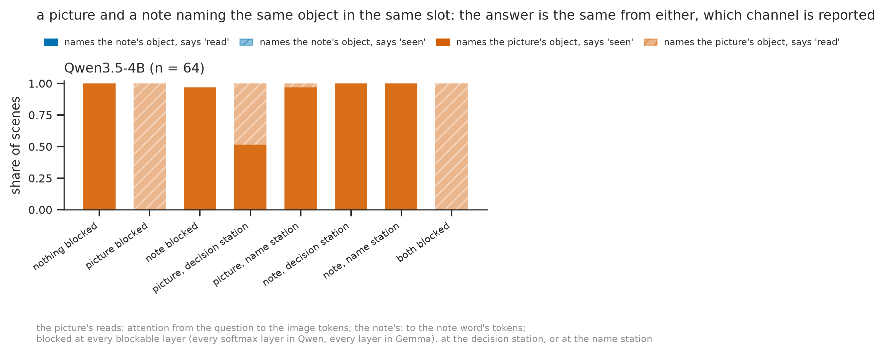
Figure: a picture and a note naming the same object; per arm, the share of scenes naming that object, orange when the report is "seen" and blue when "read". Qwen3.5-4B, 64 scenes. Source: jspace-horizons/runs/run19/Qwen3.5-4B.

22. Two misses, kept (rows 116 to 119). The rule "a decision reads the picture through the word that names its test" was tested on two held-out questions: on the 2B both fail the clean gate; on the 4B the word "animal" carries 0.39 of the animal read and the span "ride or drive" 0.16 of the ride read, under the 0.5 the rule asked for. What holds on both sizes is weaker: a decision's read lands on the question's tokens and never on the answer position (at most 0.01 of it), concentrated on the test word on the 2B and spread on the 4B. And no single head carries the 4B's evidence of having seen (row 117): the largest moves the report on 2 of 64 scenes, the decision station together on 31, every softmax read on 64. The object is carried by two heads; the channel by a sum over many reads.

23. The 27B (row 120), and your "many circuits" intuition. On Qwen3.5-27B (64 layers) the knockout finds no station: no single softmax layer costs a nat for any question, and the from-L-on costs fall gradually from layer 27 to 47. The decisions stop needing the picture at 39 (0.61 of depth), the copies at 47 (0.73), two softmax layers apart. Both of my pre-registered predictions for the decisions were wrong (a share of depth said 19, fixed layers said 11); the copies' share prediction held. So the order of the two reads survives size and the sharpness does not: the 2B and 4B read the picture through a few heads at one layer, the 27B as a sum over five. The two-station claim is scoped to models up to 4B and Gemma E4B.

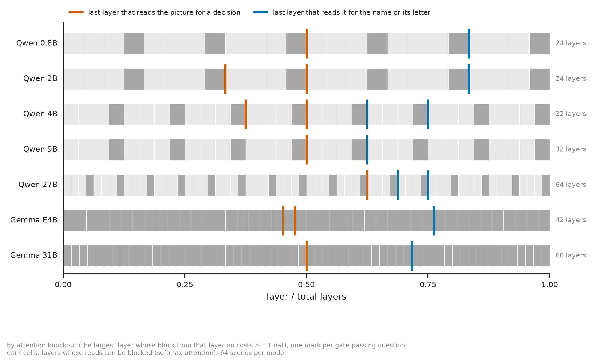
Figure: every model with a knockout, its layers as cells, the last layer that reads the picture for a decision (orange) and for the name (blue). Source: jspace-horizons/runs/run7k.

24. The 27B's interchange (row 121). With the read spread, the word's read written into the picture's run moves the animal rule only when the heads of four layers (35 to 47) go in together (0.64; a picture donor 0.94) and the name does not transfer with those layers. The interchange follows the shape of the read: two layers on the 2B, one on the 4B, four on the 27B.

25. Gemma-4-31B, two nulls kept (rows 123, 124). Blocking the question's reads of the image tokens at every third layer cost nothing, and I had missed that Gemma-4 reads the picture only through its global layers (every sixth, where E4B's readers 11, 17 and 29 sit). Blocking the ten global layers of the 31B also cost almost nothing (the name keeps 29.1 of its 30.7 nats). So on the 31B, unlike E4B, the picture does not reach the question through the global layers; its sliding window (1024) covers the whole prompt, and the decisive arm, every one of the 60 layers blocked at once, is running.

26. The interchange in the second family (row 127). On Gemma-4-E4B the heads of layer 29 recorded while the model reads "slot q contains a dog", written into the run that sees a cat, make it apply the animal rule to a dog on 1.00 of scenes (layer 17's heads: 0.64), with no single head above 0.05; the name does not transfer (0.06), as on the 4B and 27B. At layer 29 the vector a head writes for a dog seen and a dog read is the same up to the object by the cosine contrast. So the cross-modal content transfer of a decision holds in both families, and the name's transfer by head outputs is a 2B result.

27. Gemma-4-31B, every layer (row 128). With all 60 layers blockable the picture is read: all blocked loses the name 31 nats and the animal rule 17, no single layer costs half a nat, the animal rule's read ends at layer 29 (0.48 of depth) and the name's at 42 (0.70), the depths the 14 October patching gave this model. The 31B reads through its sliding layers, spread as the 27B's read is; E4B's sits in its global layers. So across 0.8B to 31B in two families: two ordered reads, decisions before names, concentrated at a few readers up to 4B and on E4B, spread over many layers at 27B and 31B.

Figure: every model with a knockout, its layers as cells, the last layer that reads the picture for a decision (orange) and for the name (blue). Source: jspace-horizons/runs/run7k and run7ka.

Running now, rules written first: Qwen3.5-9B by knockout and the E4B source report (does the decision station sit at a share of depth, softmax layer 19 of 64 on the 27B, or at a fixed layer, 11?), then the 27B's interchange and source report, and Gemma-4-31B by knockout at every third layer, which can block every layer since Gemma has softmax attention throughout; the 31B's weights are staged in memory. MathVision was tried and dropped: without chain of thought the 4B answers 2 of 60.

Limits I would state first: two Qwen sizes at single-layer resolution; the 4B's decision station is one softmax layer later than the 2B's (11 against 7) while the copy station is the same layer (19), so neither "share of depth" nor "n-th softmax layer" is an exact law yet; E4B's patching is incomplete because its per-layer inputs carry the receiver's image, so only the knockout counts there; the human labels on the judge sheets are still mine to give.

28. The report records the pathway with nothing blocked (RECORD row 129, runs/run20, figSourceCause_Qwen3.5-4B). Both outside reviews said the same thing about item 20: blocking the picture's reads also removes the picture's evidence, so a report computed from what is present would move the same way. So nothing is blocked now. The 4B sees the picture and reads the agreeing note, and a donor's heads are written in at the tokens after the image: the heads of a run that read the same note with an empty canvas make it say "read" on 64 of 64 scenes (the answer the same on every one); the heads of a run that saw another picture of the same object move 0 of 64; noise of the first donor's size moves 1 of 64. The decision station alone carries 23 of the 64, the name station 16.
29. The report exists only in the name-first order (row 130, runs/run21). Asked "seen or read, and what is it?", the 4B says "read" first on 0.98 of clean scenes whatever carried the answer, the format inference the 2B makes in both orders. So the pathway-tracking report is a judgement made after the name is written. This is a boundary I would state on the slide.
30. The 9B has the 4B's stations within one softmax layer (row 131, runs/run7k/Qwen3.5-9B, figMatrix_Qwen3.5-9B): decisions end at 15, the name at 19, single layers at 1.4 to 3.0 nats. Within Qwen the concentration is lost between 32 layers and 64. A post-hoc summary of every knockout (figAccess, figAccess.csv) says what changes with size: the depth of each read and their order do not (half of a decision's read is done by 0.39 to 0.45 of depth in six of seven models), the window's width in depth does not (0.12 to 0.28), and the share any one layer carries does (0.6 to 0.8 at 2B, 0.09 at 27B, 0.01 at 31B).
31. The answer-held source test replicates in the second family by knockout (row 132, runs/run22, figConflictSame_gemma-4-E4B-it): Gemma-4-E4B says read on 53 of 53 with the picture's reads blocked and seen on 60 of 60 with the note's, the answer held, and on E4B the decision station's reads carry all of the "seen" evidence (53 of 53 from layers 11 and 17 alone). The E4B source report by interchange was dropped untested: the name does not transfer on E4B (item 27), so it could not have been scored, as on the 27B.
